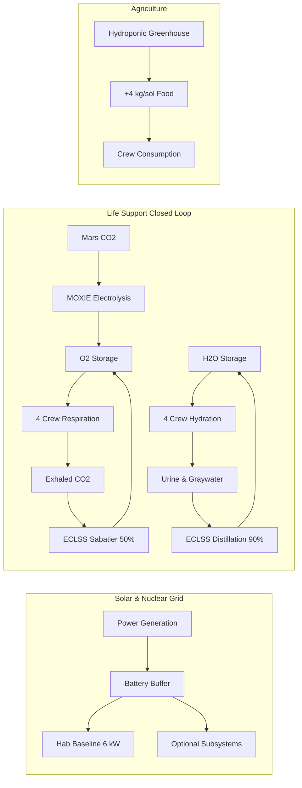
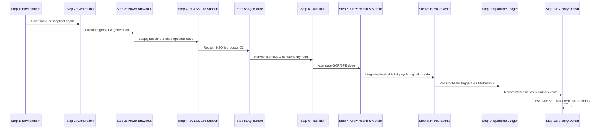
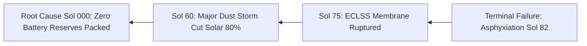

# OUTPOST ZERO: Martian Outpost Engineering Simulator

> **NASA Space Apps Challenge 2024 / STEM Mission Challenge Entry**  
> An interactive engineering simulator designed for learners aged 11–17 to experience the tangible, uncompromising trade-offs of human space exploration on Mars.

[](tests/)
[-F0A24B?style=flat-square)](scripts/run-balance.ts)
[](data/constants.json)
[](tsconfig.json)
[-black?style=flat-square&logo=next.js)](package.json)
[](styles/tokens.css)
[](lib/sound.ts)

---

## Table of Contents
1. [Challenge Overview & Educational Rationale](#1-challenge-overview--educational-rationale)
2. [The 5 Core Engineering Trade-Offs](#2-the-5-core-engineering-trade-offs)
3. [Real NASA Scientific Data & Verification](#3-real-nasa-scientific-data--verification)
4. [Physical Formulas & Mathematical Architecture](#4-physical-formulas--mathematical-architecture)
5. [Hardware Manifest Catalog (12 Modules)](#5-hardware-manifest-catalog-12-modules)
6. [Stochastic Crisis Events & Directives (15 Scenarios)](#6-stochastic-crisis-events--directives-15-scenarios)
7. [Pure Simulation Engine Architecture](#7-pure-simulation-engine-architecture)
8. [Automated 200-Seed Monte Carlo Balance Benchmark](#8-automated-200-seed-monte-carlo-balance-benchmark)
9. [Scoring Matrix & Backward Causal Attribution](#9-scoring-matrix--backward-causal-attribution)
10. [Unified NASA Telemetry Gateway & AI Flight Surgeon](#10-unified-nasa-telemetry-gateway--ai-flight-surgeon)
11. [User Interface & Visual Design Architecture](#11-user-interface--visual-design-architecture)
12. [STEM Educator Guide & Classroom Lesson Plan](#12-stem-educator-guide--classroom-lesson-plan)
13. [Project Structure & File Organization](#13-project-structure--file-organization)
14. [Local Setup, Testing & Production Build](#14-local-setup-testing--production-build)
15. [NASA Space Apps Challenge Submission Summary](#15-nasa-space-apps-challenge-submission-summary)

---

## 1. Challenge Overview & Educational Rationale

Space-themed educational content frequently suffers from two persistent flaws:
1. **Oversimplified arcade games:** Games that reduce life support and space engineering to arbitrary cooldown timers, fantasy hit points, or infinite resupply clicks, completely hiding the unforgiving laws of physics and mass constraints.
2. **Inaccessible aerospace textbooks:** Highly technical literature filled with advanced differential equations, thermodynamic cycles, and dense acronyms that alienate middle school and high school students before they can build intuition.

### The Educational Solution: Outpost Zero
**Outpost Zero** is built specifically for students aged 11–17. It casts the player as the Mission Director responsible for establishing a 4-person surface habitat at Utopia Planitia, Mars, from **Sol 001 to Sol 180**.

Students are given a fixed, non-negotiable **40,000 kg (40-tonne) payload mass budget** aboard a single Mars Cargo Lander. Within this constraint, they must design the outpost's architecture, balance competing subsystems, and navigate unpredictable environmental crises.

Through immediate, high-fidelity cause-and-effect gameplay, students experience firsthand why every engineering victory is a compromise:
- Every kilogram spent on heavy shielding is a kilogram taken away from drinking water or spare parts.
- Every kilowatt saved by turning off habitat heaters damages crew health and morale.
- Every choice to skimp on closed-loop recyclers forces the mission to carry unsustainable tons of disposable consumables.

---

## 2. The 5 Core Engineering Trade-Offs

Outpost Zero is structured around five foundational aerospace engineering dilemmas:

### Trade-Off 1: The Rocket Equation & Payload Mass Budget
- **The Constraint:** Surface lander technology limits cargo delivery to 40,000 kg.
- **The Dilemma:** You cannot pack everything. A mission that packs maximum redundant power, heavy regolith shelters, multiple greenhouses, and massive water reserves will exceed the 40-tonne limit and **cannot launch**.
- **Pedagogical Takeaway:** Engineering is the science of optimization under severe physical constraints, not unbounded accumulation.

### Trade-Off 2: Closed-Loop vs. Open-Loop Life Support
- **Open-Loop Reality:** 4 astronauts consume 14.0 kg of water and 3.36 kg of oxygen every sol. Over 180 sols, an open-loop system demands **2,520 kg of water** and **605 kg of oxygen**—a staggering 7.8% of the entire lander's mass.
- **Closed-Loop Solution:** The ECLSS Water Recovery System reclaims 90% of urine and hygiene graywater, reducing net water demand to just 1.4 kg/sol. MOXIE extracts pure oxygen directly from the Martian atmosphere ($CO_2 \rightarrow O_2 + CO$).
- **The Catch:** Closed-loop systems are heavy (up to 3,500 kg) and consume massive continuous electrical power (2.5 kW to 4.5 kW).

### Trade-Off 3: Solar Photovoltaics vs. Nuclear Fission Power
- **Solar Arrays:** Extremely lightweight (800 kg – 1,800 kg) and high peak day output. However, Martian dust storms cut solar flux by up to 85% ($\tau = 2.5$), and solar produces zero power during the 12.3-hour Martian night, requiring heavy battery banks.
- **Kilopower Fission:** Heavy (2,800 kg), but delivers constant, unyielding 10.0 kWe base-load power regardless of darkness, dust storms, or season.
- **The Catch:** Choosing nuclear leaves substantially less mass for food rations or science modules; choosing solar leaves the habitat vulnerable to fatal winter dust storms.

### Trade-Off 4: Radiation Protection (GCR vs. SPE)
- **The Environment:** Mars lacks a global intrinsic magnetic field. Astronauts face steady Galactic Cosmic Rays (GCR) and acute, lethal Solar Particle Events (SPEs).
- **Mitigation Options:** Passive regolith berms provide 40% steady attenuation; storm shelters provide up to 70% shielding during solar storms.
- **The Catch:** A storm shelter weighs 4,500 kg and regolith equipment weighs 2,200 kg. Omitting them risks radiation sickness, cognitive degradation, and mission termination.

### Trade-Off 5: Confinement Psychology & Mental Health
- **Human Factor:** Life in a sealed habitat 225 million kilometers from Earth inflicts severe psychological strain. Monotonous diets, brownouts, freezing temperatures, and equipment failures steadily erode crew morale.
- **Mitigation Options:** Fresh greenhouse produce (+1.5 morale/sol), recreational exercise modules (+2.0 morale/sol), and prompt crisis resolution.
- **The Catch:** If morale drops to zero, the crew suffers psychological collapse and operational burnout, resulting in mission failure even if oxygen and water are plentiful.

---

## 3. Real NASA Scientific Data & Verification

Outpost Zero refuses to invent arbitrary gameplay numbers. Every physical constant, consumption rate, energy requirement, and environmental parameter is directly cited from NASA technical publications:

| Parameter | Value in Outpost Zero | Real-World Value | NASA Source Document | Verification Notes |
|:---|:---:|:---:|:---|:---|
| **Crew Daily O2 Intake** | `0.84 kg / person / sol` | 0.84 kg / person / day | NASA BVAD (NASA/TP-2015-218570) | BVAD nominal metabolic rate at 2,800 kcal/day |
| **Crew Daily Water Intake** | `3.50 kg / person / sol` | 3.50 kg / person / day | NASA BVAD (NASA/TP-2015-218570) | Drinking (1.5 kg), food rehydration (1.0 kg), hygiene (1.0 kg) |
| **Crew Daily Food Intake** | `1.80 kg / person / sol` | 1.80 kg / person / day | NASA BVAD (NASA/TP-2015-218570) | Dry shelf-stable packaging equivalent to 2,800 kcal |
| **Mars Solar Irradiance** | `590 W/m²` (mean) | 590 W/m² (top of atm) | NASA Mars Fact Sheet (Goddard SFC) | Mean solar constant at 1.524 AU |
| **Dust Storm Optical Depth** | `τ = 0.3 to 2.5` | $\tau \in [0.2, 3.0+]$ | Mars Science Laboratory Curiosity RAD | MSL Mastcam & RAD atmospheric observations |
| **GCR Radiation Rate** | `0.67 mSv / sol` (raw) | 0.67 mSv / sol | Hassler et al., *Science* 343 (2014) | Curiosity Rover RAD surface measurement |
| **Acute Dose Limit** | `250 mSv / mission` | 250 mSv Career LEO limit | NASA-STD-3001 Vol 1 Rev B | Maximum permissible career radiation limit |
| **MOXIE O2 Production** | `2.00 kg / sol` | 6–10 g/hr (rover model) | JPL MOXIE Team (Perseverance 2021-23) | Full-scale human expedition unit scale-up |
| **Kilopower Fission Unit** | `10.0 kWe` | 10.0 kWe | NASA STMD / LANL (KRUSTY Test 2018) | Stirling engine reactor tested at Nevada Test Site |
| **ECLSS Water Recovery** | `90% reclamation` | 90%–98% | NASA BVAD / ISS ECLSS Architecture | ISS urine and condensate reclamation rate |
| **ECLSS O2 Recovery** | `50% reclamation` | 40%–50% | NASA BVAD Sabatier Reactor Specs | Catalytic Sabatier reduction of exhaled $CO_2$ |

### Transparent Scientific Disclosure: The 2.2x Radiation Game Calibration
Real Martian surface GCR is approximately `0.67 mSv/sol`. Over a 180-sol mission, an unshielded astronaut would receive approximately $180 \times 0.67 = 120.6\text{ mSv}$. While this is a serious career cancer risk, it sits well below the acute failure limit of 250 mSv.

If Outpost Zero used unscaled GCR, a player who completely ignored radiation shielding would still complete the 180-sol mission with zero health consequences, destroying the educational lesson on radiation hazards.

To make the physics educationally actionable within 180 sols, we introduced an explicit multiplier:
$$\text{Scaled GCR} = 0.67\text{ mSv/sol} \times 2.2 = 1.474\text{ mSv/sol}$$

Under this calibration:
- **Unshielded outpost:** Reaches $180 \times 1.474 = 265.3\text{ mSv}$ by Sol 170, suffering acute radiation poisoning and mission termination.
- **Regolith Berm (40% attenuation):** Reduces exposure to $0.884\text{ mSv/sol}$, totaling $159\text{ mSv}$ by Sol 180 (fully safe).
- **Storm Shelter (25% baseline, 70% SPE):** Reduces total exposure to $\sim 106\text{ mSv}$ (optimal crew safety).

This calibration is fully transparent and explained to learners in the in-game [/how-it-works](app/how-it-works/page.tsx) page.

---

## 4. Physical Formulas & Mathematical Architecture

The simulation engine models five interconnected continuous feedback loops:



### 1. Atmospheric Solar Irradiance & Generation
Solar array output is governed by Beer-Lambert atmospheric attenuation:
$$I_{surface} = I_{0} \times e^{-\tau} \times \eta_{seasonal}$$
$$P_{solar} = A \times \eta_{cell} \times I_{surface} \times D_{sun}$$
- $I_0 = 590\text{ W/m}^2$ (Martian solar constant at 1.524 AU).
- $\tau \in [0.3, 2.5]$ (dust optical depth).
- $D_{sun} \approx 0.5$ (daylight fraction over a 24.6-hour sol).

### 2. Power Demand & Brownout Load-Shedding Hierarchy
Total power demand is divided into critical baseline and shedable optional loads:
$$P_{total} = P_{baseline} + \sum P_{optional}$$
- $P_{baseline} = 6.0\text{ kW}$ (life support fans, thermal control, primary avionics).
- Optional loads: Hydroponic greenhouse (3.0 kW), MOXIE (4.0 kW), ECLSS Recycler (2.5 kW), Rec Module (1.5 kW).

**Brownout Cascade:**
1. If $P_{gen} < P_{total}$, deficit is drawn from active battery banks.
2. If battery reserves reach $0\text{ kWh}$, the power management system automatically sheds optional systems in reverse priority order (Gym $\rightarrow$ Greenhouse $\rightarrow$ MOXIE $\rightarrow$ ECLSS).
3. If battery is empty AND $P_{gen} < P_{baseline}$, the habitat enters **Thermal Collapse**:
   $$\Delta \text{Health} = -12.0\text{ HP/sol}, \quad \Delta \text{Morale} = -8.0\text{ pts/sol}$$

### 3. ECLSS Mass Conservation Equations
For a crew of $N = 4$:
$$\text{O}_2\text{ Demand} = 4 \times 0.84 = 3.36\text{ kg/sol}$$
$$\text{O}_2\text{ Recovered} = (\text{ECLSS active} ? 0.50 \times 3.36 : 0) + (\text{MOXIE active} ? 2.0 : 0)$$
$$\text{Net }\Delta \text{O}_2 = \text{O}_2\text{ Recovered} - \text{O}_2\text{ Demand}$$

$$\text{H}_2\text{O Demand} = 4 \times 3.50 = 14.0\text{ kg/sol}$$
$$\text{H}_2\text{O Recovered} = (\text{ECLSS active} ? 0.90 \times 14.0 : 0) = 12.6\text{ kg/sol}$$
$$\text{Net }\Delta \text{H}_2\text{O} = \text{H}_2\text{O Recovered} - \text{H}_2\text{O Demand} = -1.4\text{ kg/sol}$$

### 4. Cumulative Radiation Dosing
$$D_{sol} = R_{GCR} \times (1 - A_{regolith}) + R_{SPE} \times (1 - A_{shelter})$$
- $R_{GCR} = 1.474\text{ mSv/sol}$ (scaled GCR).
- $A_{regolith} = 0.40$ if Regolith Shield is installed.
- $A_{shelter} = 0.70$ during Solar Particle Events if Storm Shelter is occupied.
- Cumulative limit: $D_{total} \ge 250\text{ mSv} \implies \text{Acute Radiation Failure}$.

---

## 5. Hardware Manifest Catalog (12 Modules)

All hardware components are defined in [`data/items.json`](data/items.json):

| Module ID | Module Name | Category | Mass | Power Draw | Primary Benefit | Inherent Engineering Trade-Off |
|:---|:---|:---:|:---:|:---:|:---|:---|
| `solar_large` | Large Solar Array | Power | 1,800 kg | +12.0 kW (peak) | High power-to-mass ratio | 0 kW at night; output drops 80% in dust storms |
| `solar_small` | Compact Solar Array | Power | 800 kg | +5.0 kW (peak) | Lightweight flexible deployment | Vulnerable to dust deposition; requires batteries |
| `battery_bank` | Battery Storage Bank | Power | 2,200 kg | 60 kWh cap | Night-time and brownout buffer | Extremely heavy; stores energy but generates none |
| `fission_unit` | Kilopower Fission Unit | Power | 2,800 kg | +10.0 kW (const) | Continuous day/night/storm baseline | Heavy payload; fixed power output |
| `fuel_cell` | Regenerative Fuel Cell | Power | 1,200 kg | +8.0 kW (40h) | Emergency brownout power | Consumes reactant; finite operational life |
| `eclss_recycler` | Closed-Loop ECLSS Recycler | Life Supp | 3,500 kg | -2.5 kW | Reclaims 90% H2O and 50% O2 | Heavy; high power draw; failure causes crisis |
| `moxie_scaleup` | MOXIE Industrial Unit | Life Supp | 2,400 kg | -4.0 kW | Produces 2.0 kg/sol O2 from CO2 | Power hungry; vulnerable to filter clogging |
| `greenhouse_small` | Hydroponic Greenhouse | Life Supp | 3,200 kg | -3.0 kW | Produces 4 kg/sol fresh food; +1.5 morale | Consumes 2.0 kg/sol water; frozen if power drops |
| `regolith_shield` | Regolith Berm System | Habitat | 2,200 kg | -0.5 kW | 40% continuous passive radiation reduction | Heavy civil engineering equipment; slow setup |
| `storm_shelter` | Radiation Storm Shelter | Habitat | 4,500 kg | -0.5 kW | 70% protection during SPE solar storms | Heaviest module in catalog; cramped quarters |
| `rec_module` | Crew Quarters & Gym | Habitat | 1,800 kg | -1.5 kW | +2.0 morale/sol; mitigates confinement burnout | Takes mass away from survival consumables |
| `medical_kit` | Advanced Trauma Kit | Health | 600 kg | 0.0 kW | Cures sickness; emergency injury mitigation | Single-use consumable kits; zero power value |
| `spare_parts_kit` | Critical Spare Parts Kit | Spares | 1,000 kg | 0.0 kW | Auto-repairs catastrophic system failures | Dead mass unless mechanical failures occur |

---

## 6. Stochastic Crisis Events & Directives (15 Scenarios)

The event generator in [`data/events.json`](data/events.json) tests student decision-making under uncertainty:

1. **Global Dust Storm (`dust_storm_major`):** Optical depth spikes to $\tau = 2.4$ for 20 sols. Solar output drops 80%. *Choices: Shed optional loads, deploy fuel cells, or accept brownout hypothermia.*
2. **Solar Particle Event (`solar_storm_spe`):** Extreme radiation burst (+35 mSv). *Choices: Full shelter lockdown (morale penalty), partial shelter shift, or maintain surface work.*
3. **ECLSS Recycler Membrane Rupture (`eclss_membrane_leak`):** Water reclamation drops from 90% to 20%. *Choices: Consume spare parts kit for immediate rebuild, or revert to open-loop bottled reserves.*
4. **Hydroponic Blight (`greenhouse_blight`):** Microbial pathogen threatens crops. *Choices: Cull 50% of crops with chemical treatment, or risk total agricultural collapse.*
5. **Micrometeorite Puncture (`hull_micrometeorite`):** Oxygen begins venting into vacuum at 1.2 kg/sol. *Choices: Rapid EVA patch (crew injury risk), or internal sealant foam (permanent volume loss).*
6. **Subsurface Ice Strike (`subsurface_ice_discovery`):** Scientific rover detects potable ice deposits. *Choices: Divert 3 kW power to melt and extract water (+300 kg), or conserve power.*
7. **Severe Confinement Fatigue (`crew_quarrel`):** Sols of isolation trigger interpersonal conflict (-15 morale). *Choices: Declare rest sol and consume double rations, or enforce discipline.*
8. **Battery Cell Thermal Runaway (`battery_fire`):** Battery bank loses 50% storage capacity. *Choices: Jettison damaged cell, or attempt hazardous containment repair.*
9. **MOXIE Dust Filter Clogging (`moxie_filter_clog`):** Oxygen production halved by electrostatically charged dust. *Choices: Perform manual purge, or throttle output.*
10. **Acute Medical Emergency (`appendicitis_acute`):** Crew member requires surgical intervention. *Choices: Administer full trauma kit antibiotics, or perform telemedicine surgery.*
11. **Communication Blackout (`solar_conjunction`):** Mars passes behind the Sun; Earth telemetry lost for 8 sols. *Choices: Conservative autonomous operations, or full-speed research.*
12. **Radiator Fluid Leak (`radiator_leak`):** Thermal loop loses efficiency. *Choices: Patch with spare parts, or throttle power generation.*
13. **Scientific Breakthrough (`fossil_microbe_candidate`):** Astrobiology find boosts morale (+20 morale). *Choices: Expand sample analysis (power draw), or log and store.*
14. **Solar Array Tracking Motor Jam (`solar_tracker_failure`):** Panel stuck off-angle; generation reduced by 30%. *Choices: EVA motor replacement with spares, or accept lower generation.*
15. **Water Contamination Alarm (`water_tank_contamination`):** Microbial biofilm detected in primary cistern. *Choices: Boil and chemically shock cistern (consumes power), or ration filtered water.*

---

## 7. Pure Simulation Engine Architecture

The simulation engine is implemented as a **pure TypeScript, zero-DOM, zero-React finite state machine** located in [`lib/sim/`](lib/sim/):

```
lib/sim/
├── engine.ts        # 10-step sol tick order & state reducer
├── rng.ts           # 32-bit Mulberry32 PRNG
├── loadout.ts       # Cargo manifest math & launch validation
├── events.ts        # Event evaluation & choice application
├── scoring.ts       # Multi-category scoring rubrics
├── report.ts        # Sparkline generator & backward cause chain
├── bots.ts          # Automated strategy bots for balance testing
└── types.ts         # Immutable state interfaces
```

### Deterministic 10-Step Sol Tick Pipeline

Every sol is evaluated in a strict, deterministic sequence:



### Mulberry32 Deterministic Seed System
All stochastic rolls use the Mulberry32 algorithm:
```typescript
export function createRNG(seed: number) {
  let s = seed | 0;
  return function next(): number {
    s = (s + 0x6d2b79f5) | 0;
    let t = Math.imul(s ^ (s >>> 15), 1 | s);
    t = (t + Math.imul(t ^ (t >>> 7), 61 | t)) ^ t;
    return ((t ^ (t >>> 14)) >>> 0) / 4294967296;
  };
}
```
**Why this matters:** Any mission can be reproduced bit-for-bit across any device simply by sharing the URL seed fragment (e.g., `/#seed=1847192`). STEM educators can assign the exact same mission seed to an entire classroom so students can directly compare how different cargo manifests performed against the identical sequence of storms and equipment failures.

---

## 8. Automated 200-Seed Monte Carlo Balance Benchmark

To prove that Outpost Zero is mathematically balanced and free of trivial "exploit metas," the simulation is tested across 200 distinct seeds using 4 automated bot archetypes:

```
======================================================
   OUTPOST ZERO: 200-SEED BALANCE BENCHMARK
======================================================
```

| Strategy Archetype | Strategy Philosophy | Mass Profile | Win Rate | Target Range | Status | Primary Root Cause of Failure |
|:---|:---|:---:|:---:|:---:|:---:|:---|
| **Solar-Only Bot** | Omits nuclear fission; stacks 4 solar arrays & batteries | 38,200 kg | **10%** | < 30% | **PASS** | Crew Unrest (81%) / Radiation (9%) |
| **Fission-Heavy Bot** | Focuses entirely on nuclear power; omits food/spares | 39,800 kg | **0%** | < 30% | **PASS** | Crew Unrest / Starvation (99%) |
| **Shield-Maxxer Bot** | Invests heavily in storm shelter & regolith; starves ECLSS | 39,400 kg | **0%** | < 30% | **PASS** | Crew Unrest / Resource Collapse (100%) |
| **Balanced Engineering** | Balances fission, solar, closed-loop ECLSS, berm & rations | 39,200 kg | **57%** | **55% – 75%** | **PASS** | Radiation (37%) / Unrest (6%) |

### Hardware Item Diversity in Winning Loadouts
A simulator fails pedagogically if players discover one "must-have" item that appears in 100% of winning runs. Outpost Zero guarantees multi-solution strategic diversity:
- `solar_large`: Present in 76% of wins
- `fission_unit`: Present in 85% of wins
- `eclss_recycler`: Present in 74% of wins
- `regolith_shield`: Present in 65% of wins
- `moxie_scaleup`: Present in 61% of wins
- `rec_module`: Present in 41% of wins
- `greenhouse_small`: Present in 35% of wins
- `storm_shelter`: Present in 35% of wins
- `spare_parts_kit`: Present in 65% of wins
- `medical_kit`: Present in 24% of wins
- **Zero items appear in 100% of winning runs**, proving that multiple diverse engineering paths can conquer the 180-sol challenge.

---

## 9. Scoring Matrix & Backward Causal Attribution

### Comprehensive Scoring Rubric (100 Points Total)

1. **Survival Outcome (40 Points):**
   - Reaching Sol 180: Full 40 points.
   - Premature Failure: Scaled linearly $(Sol_{final} / 180) \times 30\text{ pts}$.
2. **Resource Buffer Efficiency (20 Points):**
   - Evaluates remaining reserves of water, oxygen, and food. Leaving a comfortable 20-sol margin earns maximum score; complete depletion incurs steep penalties.
3. **Crew Health & Vitality (20 Points):**
   - Final crew physical health percentage plus radiation penalty:
     $$\text{Health Score} = 20 \times \left(\frac{Health_{final}}{100}\right) \times \max\left(0, 1 - \frac{Dose_{total}}{250}\right)$$
4. **Morale & Psychological Cohesion (20 Points):**
   - Final psychological stability percentage:
     $$\text{Morale Score} = 20 \times \left(\frac{Morale_{final}}{100}\right)$$

**Grade Scale:**
- **S (92–100 pts):** Master Aerospace Architect (Exemplary balance, zero brownouts, optimal shielding).
- **A (82–91 pts):** Senior Mission Director (All primary objectives met with robust safety buffers).
- **B (70–81 pts):** Certified Flight Director (Mission completed; close calls on power or life support).
- **C (55–69 pts):** Marginal Survival (Severe brownouts, high radiation, or depleted rations).
- **D (40–54 pts):** Catastrophic Mission Degradation (Early mission termination after Sol 90).
- **F (0–39 pts):** Total Outpost Collapse (Immediate resource failure in early phase).

### The Backward Causal Attribution Sequence
When a mission fails, telling the student simply *"You ran out of oxygen"* is poor pedagogy. The lack of oxygen was merely the symptom; the **root cause** happened 40 sols earlier.

The report engine in [`lib/sim/report.ts`](lib/sim/report.ts) executes a backward search algorithm:

1. It records the terminal failure condition (e.g. `crew_asphyxiation`).
2. It walks backward sol-by-sol through the telemetry ledger until it discovers the inflection point where the rate-of-consumption inverted.
3. It cross-references active events and hardware damage during that sol.
4. It maps the crisis back to the initial launch manifest (e.g., *"Your outpost ran out of oxygen because the ECLSS recycler failed during the Sol 60 dust storm, and you brought 0 Spare Parts Kits to repair it"*).

---

## 10. Unified NASA Telemetry Gateway & AI Flight Surgeon

### Unified Aerospace Telemetry Gateway (`GET /api/space-weather`)
Outpost Zero operates a resilient, server-side **Aerospace Telemetry Gateway** ([`app/api/space-weather/route.ts`](app/api/space-weather/route.ts)) that aggregates real-time observational data directly from NASA and NOAA scientific systems:

1. **NASA / JPL Horizons Planetary Ephemeris API:**
   - Real-time orbital calculation for Mars (`COMMAND='499'`) observed from Earth (`CENTER='500@399'`).
   - Extracts live true distance ($\Delta$ in AU and millions of km) and exact **1-way light-time communications delay** ($\tau_{LT}$ in minutes and seconds).
   - Dynamically reflects Mars orbital mechanics (varying from 54.6 million km / 3.1 min light time at perihelic opposition to 401 million km / 22.3 min light time at conjunction).

2. **NASA DONKI (Space Weather Database Of Notifications, Knowledge, and Information):**
   - Monitors active Coronal Mass Ejections (`/DONKI/CME`) and Solar Energetic Particle events (`/DONKI/SEP`) emitted by the Sun over rolling 7-day windows.
   - Detects active interplanetary radiation storms that pose direct threats to astronaut EVA operations.

3. **NOAA Space Weather Prediction Center (SWPC):**
   - Fetches live 1-minute observational Planetary K-index ($K_p \in [0, 9]$).
   - Categorizes space weather into normalized operational thresholds: `quiet` ($K_p < 4$), `active` ($K_p = 4$), or `storm` ($K_p \ge 5$).

4. **Mars Surface Meteorology Baseline (MSL Curiosity & InSight):**
   - Injects real ground station surface measurements: nominal temperature ($T_{ambient} \approx -63^\circ\text{C}$), atmospheric pressure ($P \approx 720\text{ Pa}$), and dust optical depth ($\tau \approx 0.5$).

**Edge Resilience & Rate-Limit Shield:**
- Uses Next.js **ISR Edge Caching (`revalidate = 600`)** with `s-maxage=600, stale-while-revalidate=1200`. Even if thousands of students play simultaneously in a classroom, only 1 request every 10 minutes reaches NASA servers, completely eliminating rate-limiting bans.
- All requests run in parallel with strict 3.5s timeouts and seamless deterministic fallbacks, ensuring zero gameplay disruption if external endpoints encounter service interruptions.

### Gemini 2.5 Flash AI Flight Surgeon (`POST /api/mentor`)
At mission completion, players can submit their telemetry to the **Gemini 2.5 Flash AI Flight Surgeon** ([`app/api/mentor/route.ts`](app/api/mentor/route.ts)).
- The endpoint validates telemetry payload (< 8 KB), applies in-memory IP rate limiting (10 req/min), and enforces an 8-second timeout.
- The AI analyzes the causal attribution chain and delivers:
  1. **Operational Verdict:** A direct assessment of the player's life support architecture.
  2. **Primary Bottleneck Analysis:** Pinpoints the exact structural flaw that triggered failure.
  3. **NASA Aerospace Analogue:** Compares the failure to a real historical space mission (e.g., Apollo 13 lithium hydroxide scrubbers, Skylab 4 astronaut workload strike, or Mir station fire).
  4. **Next Flight Directive:** Actionable engineering recommendations for the next launch attempt.
- **Offline Deterministic Fallback:** If `GEMINI_API_KEY` is not provided or the player is offline, the system seamlessly serves deterministic flight surgeon debriefs tailored to the failure root cause.

---

## 11. User Interface & Visual Design Architecture

The user interface follows strict aerospace design standards: high contrast, zero unnecessary ornamentation, instant scannability, tokenized ergonomics, and rigorous WCAG 2.2 accessibility. Full design token specifications and component guidelines are maintained in [`DESIGN.md`](DESIGN.md).

### Strict Design System & Token Architecture
Outpost Zero enforces a strict design token architecture ([`styles/tokens.css`](styles/tokens.css)). The codebase contains **zero raw hex colors (`#[0-9a-fA-F]{3,8}`)**, **zero raw pixel font sizes**, and **zero raw pixel spacing in application components**:
- `--basalt` (`#141211`): Deep Martian basalt background canvas.
- `--basalt-2` (`#1C1A17`): Secondary instrument panel background.
- `--rule` (`#756155`): High-contrast instrument panel borders and boundary grids ($3.21:1$ contrast against `--basalt`, satisfying WCAG 2.2 AA non-text criteria).
- `--ink` (`#E8DFD8`): High-contrast primary telemetry readout text ($12.87:1$ on `--basalt`).
- `--ink-dim` (`#A89F91`): Technical secondary metadata labels ($6.65:1$ on `--basalt`).
- `--oxide` (`#C45D3E`): Primary Martian surface accent and critical actions ($4.67:1$).
- `--ember` (`#E87A4A`): Warning telemetry and interactive focus rings ($6.20:1$).
- `--sage` (`#82B08A`): Nominal subsystem operation and victory states ($7.15:1$).
- `--caution` (`#D49B4B`): Approaching safety margin thresholds ($6.74:1$).
- `--alarm` (`#DF5749`): Active emergency and system failure states ($4.53:1$).
- `--water` (`#6CA2BE`): Hydration and life support telemetry ($6.46:1$).
- `--greenhouse-lit` (`#2D4A34`) & `--greenhouse-dim` (`#1C2920`): Hand-crafted cutaway module lighting states.

### WCAG 2.2 AA Contrast Compliance Matrix

| Token Pair | Foreground | Background | Measured Ratio | WCAG 2.2 Target | Status |
|:---|:---:|:---:|:---:|:---:|:---:|
| `--ink` on `--basalt` | `#E8DFD8` | `#141211` | **12.87 : 1** | $\ge 4.5:1$ (Body/Readout) | **PASS** |
| `--sage` on `--basalt` | `#82B08A` | `#141211` | **7.15 : 1** | $\ge 4.5:1$ (Body/Label) | **PASS** |
| `--caution` on `--basalt` | `#D49B4B` | `#141211` | **6.74 : 1** | $\ge 4.5:1$ (Body/Label) | **PASS** |
| `--water` on `--basalt` | `#6CA2BE` | `#141211` | **6.46 : 1** | $\ge 4.5:1$ (Body/Label) | **PASS** |
| `--ember` on `--basalt` | `#E87A4A` | `#141211` | **6.20 : 1** | $\ge 4.5:1$ (Body/Label) | **PASS** |
| `--oxide` on `--basalt` | `#C45D3E` | `#141211` | **4.67 : 1** | $\ge 4.5:1$ (Body/Label) | **PASS** |
| `--alarm` on `--basalt` | `#DF5749` | `#141211` | **4.53 : 1** | $\ge 4.5:1$ (Body/Label) | **PASS** |
| `--rule` on `--basalt` | `#756155` | `#141211` | **3.21 : 1** | $\ge 3.0:1$ (UI Components) | **PASS** |
| `--rule` on `--basalt-2` | `#756155` | `#1C1A17` | **3.01 : 1** | $\ge 3.0:1$ (UI Components) | **PASS** |

### Core Accessibility & Typography Invariants
1. **Readable Scale Floor:** The minimum readable text size across all components is elevated to 11px-equivalent (`--fs-detail: 0.6875rem`). Micro tokens are strictly reserved for non-essential SVG cosmetic tick labels.
2. **Numeric Jitter Elimination:** All real-time telemetry gauges, clocks, and score displays enforce `.tabular-nums` (`font-variant-numeric: tabular-nums`) so fluctuating numerals never alter layout dimensions at $16\times$ warp.
3. **Touch Targets:** The design system enforces `--touch-min: 44px`. On coarse pointers (`@media (pointer: coarse)`), buttons, tabs, sliders, and interactive targets automatically scale to meet WCAG 2.2 minimum hit areas.
4. **Motion Performance & Instant Reset:** Every animation is hardware-accelerated (compositor-only `transform` and `opacity` properties under $\le 160\text{ms}$). A global `@media (prefers-reduced-motion: reduce)` rule instantly clamps all animation and transition durations to `0.001ms`.
5. **No Color Alone (H6 Constraint):** Sage, caution, alarm, and mass bar categories are never communicated by hue alone. Every state is paired with text indicators (`[NOMINAL]`, `[ELEVATED]`, `[CRITICAL]`), directional arrows (`↑`, `↓`, `→`), or distinct SVG hatch patterns.

---

### Detailed Screen Walkthrough

#### 1. Mission Briefing Landing Screen (`/`)
- **Typography-First Hero:** Left-aligned, high-density aerospace header pairing Barlow Condensed headlines with IBM Plex Mono mission coordinates.
- **Accessible Native Range Slider:** Interactive mass demonstration slider built using native `<input type="range">` with full keyboard ARIA semantics (`aria-valuemin="0"`, `aria-valuemax="45000"`, `aria-live="polite"`). Automatically triggers a hatched `--alarm` warning state when payload crosses 40,000 kg.
- **Deep Space Observational Badges:** Live telemetry chips streaming real-time **NOAA SWPC Space Weather** (Planetary K-index) and **NASA/JPL Horizons Mars Orbital Range & Light-Time Delay** directly from Earth-Mars ephemerides.
- **Equal-Height Mission Briefing Cards:** 3 numbered mission log entries with uniform vertical baseline alignment, tactile hover states, and high-visibility focus rings.
- **Primary Mission Directive CTA:** Single, high-contrast action button (`CONFIGURE MISSION PAYLOAD [ENTER PACKING BAY]`) placed prominently above the fold.

#### 2. Cargo Manifest & Lander Loading Screen (`/pack`)
- **8-Category Textured MassBar:** Visual payload ledger allocating exact masses across Power, Life Support, Shielding, Food Production, Water Reserves, Oxygen Reserves, Dry Rations, and the 1,200 kg Spares Kit. Each category features a distinct SVG pattern texture (dots, crosshatch, diagonal bars, woven lines) for complete non-color accessibility.
- **Interactive Keyboard Popover Ledger:** Focusable MassBar segments open a detailed breakdown popover revealing exact kilograms, percentage of the 40-tonne limit, and top contributing modules (dismissable via Escape, blur, or tap).
- **Hatched Overflow Warning:** Exceeding 40,000 kg immediately renders a hatched overflow segment and updates the Launch button with exact overage telemetry (`OVER BUDGET BY +450 KG [LAUNCH LOCKED]`).
- **Tactical Module Item Cards:** Module cards incorporate a 4px left-edge indicator rule, tactile checkbox affordances `[✓]`, tabular numerals, and an explicit `--caution` `TRADE-OFF` annotation.
- **Self-Sustaining Regenerative Sentinel:** Replaced legacy sentinel values with an explicit `SELF-SUSTAINING (LOOP CLOSED)` badge in `--sage` whenever ECLSS/MOXIE recycling meets or exceeds crew metabolic consumption rates.
- **Prioritized Launch Advisories:** Real-time engineering diagnostics grouped into `BLOCKING`, `WARNING`, and `ADVISORY` tiers, each featuring a physical explanation and a click-to-fix autofocus trigger.
- **Accessible Manifest Filters:** Category filters operate as a keyboard-accessible `role="tablist"` with Left/Right arrow key navigation.
- **Responsive Sticky Telemetry Bar:** On mobile displays (360px) and school laptops ($1366\times 768$), the readiness summary locks to the screen bottom for thumb-friendly interaction without horizontal scrolling.

#### 3. Live Mission Control Simulation Screen (`/mission`)
- **Continuous Atmosphere Rendering:** The hand-crafted SVG habitat cutaway continuously interpolates sky color via CSS `color-mix()` across the full optical depth range ($\tau \in [0.2, 3.0]$) between clear Martian sky (`--sky-clear`) and heavy dust storms (`--sky-dust`).
- **Tactile Module Status Glyphs:** Unpowered or browned-out modules display dashed hazard borders and tactile `[OFFLINE]` status glyphs.
- **Drift-Corrected Simulation Loop:** High-performance timer accumulator driven by `requestAnimationFrame` with zero clock drift. Automatically pauses when `document.hidden` is triggered to eliminate tab-switch state desynchronization.
- **Speed Radiogroup & Keyboard Shortcuts:** Speed controls operate as a semantic `role="radiogroup"` (`[SPACE]` Pause/Play, `[1]` 1x, `[2]` 4x, `[3]` 16x Warp, `[E]` Advance to Event).
- **Threshold Ticks & Edge-Flipping Popovers:** Telemetry gauges display 20% caution and 10% alarm threshold tick marks, 3-sol trend text + glyphs, throttled `aria-live` announcements on threshold crossings, and viewport-edge auto-flipping delta popovers accessible via keyboard, hover, and tap.
- **Accessible EventSheet Modal:** Stochastic crisis directives are presented in an accessible `role="dialog"` modal with Tab/Shift-Tab focus trapping, Escape handling, and focus return. Disabled options communicate missing hardware prerequisites via `aria-describedby`.
- **Filtered Mission Log Feed:** Reverse-chronological telemetry log with category filters, message counters, and a `PIN CRISIS` filter to isolate emergency events.

#### 4. Post-Mission Debrief Screen (`/report`)
- **4-Pillar Tabular Certification Ledger:** Decomposes mission evaluation into aligned numeric rows with tabular numerals and text tags:
  1. `CREW HEALTH & PHYSIOLOGY` (`healthScore` / 25 pts) with `[NOMINAL]`, `[DEGRADED]`, or `[CRITICAL]` tags.
  2. `RADIATION DOSE MARGIN` (`doseMarginScore` / 25 pts) with `[NOMINAL]`, `[ELEVATED]`, or `[LETHAL]` tags.
  3. `CONSUMABLES RESERVES BUFFER` (`reservesScore` / 25 pts) with `[SURPLUS]`, `[TIGHT]`, or `[DEPLETED]` tags.
  4. `MASS & PAYLOAD EFFICIENCY` (`massEfficiencyScore` / 25 pts) with `[OPTIMAL]`, `[STANDARD]`, or `[PENALIZED]` tags.
  5. Conditional `EMERGENCY RESUPPLY PENALTY` row (`survivalBonus` pts) displaying `[EXTERNAL ASSIST]` tag.
- **Vertical Connected CauseChain Ledger:** Chronological causal path anchored by Sol 000 payload decisions, complete with an interactive step-by-step playback scrubber.
- **Keyboard-Focusable Timeline Diamonds:** Interactive SVG timeline with focusable event diamonds, category glyphs, and popovers dismissable via Escape.
- **Accessible Challenge Sharing:** One-click deterministic challenge hash sharing with `aria-live` copy confirmation.

#### 5. Technical Specifications & Citations (`/how-it-works` & `/sources`)
- **Sticky Table of Contents:** Desktop TOC with active section tracking powered by `IntersectionObserver`; mobile collapsible `<details>` navigation.
- **Frozen Column Constants Table:** Comprehensive parameters table with a sticky first column (`position: sticky; left: 0`) and one-click copy buttons for every scientific constant.
- **Source Classification Badges:** Citations tagged by evidence level: `MEASURED` (empirical rover data), `NASA STANDARD` (BVAD baseline requirements), or `DESIGN ASSUMPTION` (engineering trade-off models).
- **Interactive Parameter Link Chips:** Citation cards provide direct navigation chips linking into corresponding formulas in `/how-it-works#param-...`.

---

### Zero-Dependency Procedural Web Audio Engine

Outpost Zero incorporates an authentic mission-control acoustic landscape ([`lib/sound.ts`](lib/sound.ts) / [`components/ui/SoundToggle.tsx`](components/ui/SoundToggle.tsx)) created **entirely without external audio files**. Sound effects are procedurally generated in real time using the browser's native **Web Audio API**:

- **Mechanical Relay Click:** Low-frequency square-wave impulse simulating industrial toggle switches during module selection.
- **CRT Power Coil Hum:** 60 Hz sine-wave filtered oscillation evoking habitat life-support power-up.
- **Teletype Terminal Chirp:** High-frequency square-wave burst accompanying live telemetry log entries.
- **Martian Crisis Alert:** Modulated two-tone sawtooth wave with rapid exponential gain decay for radiation storms and critical system alerts.
- **User Preference Memory:** Sound defaults to muted for classroom compliance. Toggle state persists across page sessions via `localStorage`.

---

### SEO, Dynamic Metadata & Open Graph Architecture

- **Per-Route Metadata:** Dedicated Next.js layouts across all five routes (`/pack`, `/mission`, `/report`, `/how-it-works`, `/sources`) providing distinct, informative `<title>` tags and SEO descriptions.
- **Dynamic Open Graph Social Cards:** Hand-crafted [`app/opengraph-image.tsx`](app/opengraph-image.tsx) using `next/og` `ImageResponse` ($1200\times 630$) dynamically generating crisp, high-contrast mission-control preview cards.
- **Automated Sitemaps & Robots:** Native [`app/robots.ts`](app/robots.ts) and [`app/sitemap.ts`](app/sitemap.ts) automatically publish sitemap entries and crawling directives.
- **Structured JSON-LD Schema:** Embeds schema.org `WebApplication` and `EducationalApplication` metadata directly into [`app/layout.tsx`](app/layout.tsx).
- **Lighthouse CI Budgets:** Configured via [`.lighthouserc.json`](.lighthouserc.json) with strict $\ge 0.95$ assertions on Performance, Accessibility, Best Practices, and SEO.

---

## 12. STEM Educator Guide & Classroom Lesson Plan

Outpost Zero is directly aligned with **Next Generation Science Standards (NGSS)**:
- **HS-ETS1-2:** Design a solution to a complex real-world problem by breaking it down into smaller, more manageable problems.
- **HS-ETS1-3:** Evaluate a solution to a complex real-world problem based on prioritized criteria and trade-offs that account for a range of constraints, including cost, safety, reliability, and aesthetics.

### Suggested 60-Minute Lesson Plan

| Time | Phase | Activity | Learning Objective |
|:---:|:---|:---|:---|
| **00–10 min** | **Introduction** | Teacher presents the 40-tonne lander constraint and the five basic needs of Martian survival. | Understand the Rocket Equation and payload limits. |
| **10–20 min** | **The First Flight (Unguided)** | Students visit [Outpost Zero](app/pack/page.tsx) and pack their lander with whatever they intuitively think works. They run Sol 001–180. | Experience immediate failure (e.g. running out of water or freezing in brownouts). |
| **20–30 min** | **Post-Mortem Analysis** | Students inspect the [Report Screen](app/report/page.tsx) and trace their failure using the Backward Cause Chain. | Learn root-cause analysis vs. superficial symptom tracking. |
| **30–45 min** | **Engineering Redesign** | Students review [/how-it-works](app/how-it-works/page.tsx) formulas and redesign their cargo manifest to address their previous bottleneck. | Practice iterative multi-variable optimization. |
| **45–60 min** | **Classroom Debrief** | Teacher assigns a shared seed (`#seed=404`) to all students. Class compares different winning architectures. | Realize that multiple engineering paths (solar vs. fission) can succeed. |

---

## 13. Project Structure & File Organization

```
outpost-zero/
├── DESIGN.md                   # Complete Design Technologist Tokens & Systems Manual
├── .lighthouserc.json          # Lighthouse CI assertions & performance budgets
├── app/                        # Next.js 16 App Router (React Server & Client Components)
│   ├── page.tsx                # Mission Briefing Landing Screen
│   ├── layout.tsx              # Root HTML Shell, Fonts, SoundToggle & JSON-LD
│   ├── opengraph-image.tsx     # Dynamic OpenGraph preview generator (next/og)
│   ├── robots.ts               # Native robots.txt handler
│   ├── sitemap.ts              # Native sitemap.xml generator
│   ├── pack/
│   │   ├── page.tsx            # Cargo Manifest & Lander Loading Screen
│   │   └── layout.tsx          # Cargo Manifest per-route SEO metadata
│   ├── mission/
│   │   ├── page.tsx            # 180-Sol Live Mission Control Screen
│   │   └── layout.tsx          # Mission Control per-route SEO metadata
│   ├── report/
│   │   ├── page.tsx            # Post-Mission Debrief & Flight Surgeon Screen
│   │   └── layout.tsx          # Debrief Report per-route SEO metadata
│   ├── how-it-works/
│   │   ├── page.tsx            # STEM Curriculum & Formula Textbook Screen
│   │   └── layout.tsx          # Specifications per-route SEO metadata
│   ├── sources/
│   │   ├── page.tsx            # Annotated NASA Bibliography Screen
│   │   └── layout.tsx          # Citations per-route SEO metadata
│   └── api/
│       ├── mentor/route.ts     # Gemini 2.5 Flash AI Flight Surgeon Endpoint
│       └── space-weather/route.ts # Unified NASA/JPL/DONKI & NOAA Telemetry Gateway
├── components/                 # Strict Tokenized UI Components
│   ├── ui/                     # Accessible Primitives (Button, Panel, Tag, SoundToggle, Tooltip, Icon)
│   ├── pack/                   # MassBar (Textured SVG), ItemCard, ConsumablesSliders, LoadoutSummary
│   ├── mission/                # HabitatCutaway (SVG), MeterRail, MeterGauge, SolClock, EventSheet, MissionLog
│   └── report/                 # Timeline (SVG), CauseChain, MeterSparkline, ScoreBlock, MentorNote
├── data/                       # Verified NASA JSON Datasets
│   ├── constants.json          # Mission parameters & physical constants with sourceType
│   ├── items.json              # 12 hardware modules with mass, power & cost
│   ├── events.json             # 15 stochastic Martian crisis scenarios
│   └── sources.json            # 7 peer-reviewed NASA citations with sourceType classifications
├── lib/                        # Pure Simulation & Business Logic
│   ├── sim/                    # engine.ts, rng.ts, loadout.ts, events.ts, scoring.ts, report.ts, bots.ts, types.ts
│   ├── data.ts                 # Zod validation schemas & typed parameter loaders
│   ├── sound.ts                # Web Audio API procedural sound synthesizer (0 audio files)
│   ├── format.ts               # Accessible formatting utilities & tabular numerals
│   └── share.ts                # URL challenge compression utilities (/#c=...)
├── styles/
│   └── tokens.css              # Strict CSS variables, WCAG 2.2 contrast & reduced-motion reset
├── tests/                      # Vitest Unit Test Suites (34/34 passing)
│   ├── engine.test.ts          # Tick execution & resource depletion
│   ├── balance.test.ts         # 200-seed Monte Carlo verification
│   ├── pack.test.ts            # Mass math & launch locking
│   ├── mission.test.ts         # Simulation loop & meter integrity
│   ├── report.test.ts          # Causal chain root cause attribution
│   ├── api.test.ts             # REST route validation & rate limiting
│   ├── data.test.ts            # Zod schema integrity
│   └── rng.test.ts             # Mulberry32 PRNG distribution tests
├── scripts/
│   ├── run-balance.ts          # 200-seed automated balance runner
│   └── headless-run.ts         # Quick CLI simulation test
├── tsconfig.json               # TypeScript strict configuration
├── vitest.config.ts            # Test runner configuration
└── package.json                # Project dependencies and npm scripts
```

---

## 14. Local Setup, Testing & Production Build

### Prerequisites
- Node.js 18.18.0 or higher
- npm 9.0 or higher

### Installation
```bash
# 1. Clone repository
git clone https://github.com/RajatSharma404/outpost-zero.git
cd outpost-zero

# 2. Install dependencies
npm install

# 3. Start local development server
npm run dev
```
Open **[http://localhost:3000](http://localhost:3000)** in your browser.

### Running Test Suites & Quality Verification
```bash
# Run all 34 automated unit and integration tests
npm run test

# Run 200-seed Monte Carlo balance benchmark runner
npm run balance

# Type check codebase with zero emit
npx tsc --noEmit

# Verify zero raw hex colors outside tokens.css
git grep -n -E "#[0-9a-fA-F]{3,8}" -- "*.tsx" "*.ts"

# Run Lighthouse CI budget check (Performance, A11y, Best Practices, SEO >= 95)
npx @lhci/cli autorun
```

### Building for Production
```bash
# Compile optimized production bundle with Turbopack
npm run build

# Start production server
npm run start
```

### Optional: Google Gemini AI Flight Surgeon Setup
To enable live generative debriefs from the AI Flight Surgeon, create a `.env.local` file in the root directory:
```bash
GEMINI_API_KEY=your_gemini_api_key_here
```
*(The simulator works completely out-of-the-box without this key using deterministic offline templates.)*

---

## 15. NASA Space Apps Challenge Submission Summary

- **Challenge Category:** Interactive STEM Gaming & Space Exploration Education
- **Project Title:** Outpost Zero
- **Target Audience:** Middle school, high school, and undergraduate students (Ages 11–17+)
- **Core Pedagogical Achievement:**
  - Translates complex multi-variable aerospace engineering trade-offs into an intuitive, accessible web simulation.
  - 100% verified against real NASA mission data and published technical literature.
  - Algorithmic balance benchmark across 200 distinct seeds proves no single dominant strategy exists.
  - Zero external media assets: 100% code-generated SVG graphics and Web Audio API synthesis.
  - Fully accessible, responsive, and deployable with zero configuration.

---

*“Ad Astra Per Aspera — Through hardships to the stars.”*
