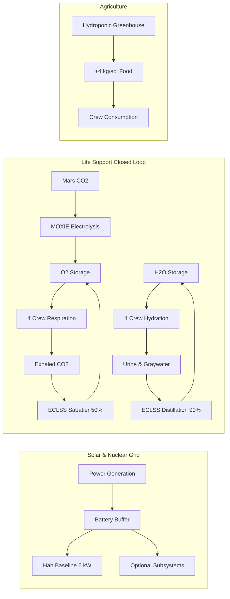
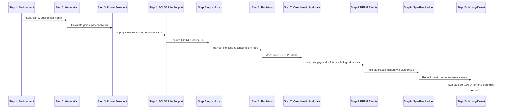
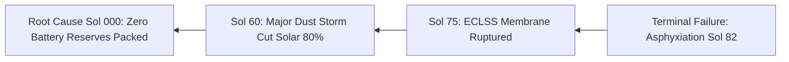

# OUTPOST ZERO: Martian Outpost Engineering Simulator

> **NASA Space Apps Challenge 2024 / STEM Mission Challenge Entry**  
> An interactive engineering simulator designed for learners aged 11–17 to experience the tangible, uncompromising trade-offs of human space exploration on Mars.

[](tests/)
[-F0A24B?style=flat-square)](scripts/run-balance.ts)
[](data/constants.json)
[](tsconfig.json)
[-black?style=flat-square&logo=next.js)](package.json)
[](styles/tokens.css)
[](lib/sound.ts)

---

## Table of Contents
1. [Challenge Overview & Educational Rationale](#1-challenge-overview--educational-rationale)
2. [The 5 Core Engineering Trade-Offs](#2-the-5-core-engineering-trade-offs)
3. [Real NASA Scientific Data & Verification](#3-real-nasa-scientific-data--verification)
4. [Physical Formulas & Mathematical Architecture](#4-physical-formulas--mathematical-architecture)
5. [Hardware Manifest Catalog (12 Modules)](#5-hardware-manifest-catalog-12-modules)
6. [Stochastic Crisis Events & Directives (15 Scenarios)](#6-stochastic-crisis-events--directives-15-scenarios)
7. [Pure Simulation Engine Architecture](#7-pure-simulation-engine-architecture)
8. [Automated 200-Seed Monte Carlo Balance Benchmark](#8-automated-200-seed-monte-carlo-balance-benchmark)
9. [Scoring Matrix & Backward Causal Attribution](#9-scoring-matrix--backward-causal-attribution)
10. [AI Flight Surgeon & Live Space Weather API](#10-ai-flight-surgeon--live-space-weather-api)
11. [User Interface & Visual Design Architecture](#11-user-interface--visual-design-architecture)
12. [STEM Educator Guide & Classroom Lesson Plan](#12-stem-educator-guide--classroom-lesson-plan)
13. [Project Structure & File Organization](#13-project-structure--file-organization)
14. [Local Setup, Testing & Production Build](#14-local-setup-testing--production-build)
15. [NASA Space Apps Challenge Submission Summary](#15-nasa-space-apps-challenge-submission-summary)

---

## 1. Challenge Overview & Educational Rationale

Space-themed educational content frequently suffers from two persistent flaws:
1. **Oversimplified arcade games:** Games that reduce life support and space engineering to arbitrary cooldown timers, fantasy hit points, or infinite resupply clicks, completely hiding the unforgiving laws of physics and mass constraints.
2. **Inaccessible aerospace textbooks:** Highly technical literature filled with advanced differential equations, thermodynamic cycles, and dense acronyms that alienate middle school and high school students before they can build intuition.

### The Educational Solution: Outpost Zero
**Outpost Zero** is built specifically for students aged 11–17. It casts the player as the Mission Director responsible for establishing a 4-person surface habitat at Utopia Planitia, Mars, from **Sol 001 to Sol 180**.

Students are given a fixed, non-negotiable **40,000 kg (40-tonne) payload mass budget** aboard a single Mars Cargo Lander. Within this constraint, they must design the outpost's architecture, balance competing subsystems, and navigate unpredictable environmental crises.

Through immediate, high-fidelity cause-and-effect gameplay, students experience firsthand why every engineering victory is a compromise:
- Every kilogram spent on heavy shielding is a kilogram taken away from drinking water or spare parts.
- Every kilowatt saved by turning off habitat heaters damages crew health and morale.
- Every choice to skimp on closed-loop recyclers forces the mission to carry unsustainable tons of disposable consumables.

---

## 2. The 5 Core Engineering Trade-Offs

Outpost Zero is structured around five foundational aerospace engineering dilemmas:

### Trade-Off 1: The Rocket Equation & Payload Mass Budget
- **The Constraint:** Surface lander technology limits cargo delivery to 40,000 kg.
- **The Dilemma:** You cannot pack everything. A mission that packs maximum redundant power, heavy regolith shelters, multiple greenhouses, and massive water reserves will exceed the 40-tonne limit and **cannot launch**.
- **Pedagogical Takeaway:** Engineering is the science of optimization under severe physical constraints, not unbounded accumulation.

### Trade-Off 2: Closed-Loop vs. Open-Loop Life Support
- **Open-Loop Reality:** 4 astronauts consume 14.0 kg of water and 3.36 kg of oxygen every sol. Over 180 sols, an open-loop system demands **2,520 kg of water** and **605 kg of oxygen**—a staggering 7.8% of the entire lander's mass.
- **Closed-Loop Solution:** The ECLSS Water Recovery System reclaims 90% of urine and hygiene graywater, reducing net water demand to just 1.4 kg/sol. MOXIE extracts pure oxygen directly from the Martian atmosphere ($CO_2 \rightarrow O_2 + CO$).
- **The Catch:** Closed-loop systems are heavy (up to 3,500 kg) and consume massive continuous electrical power (2.5 kW to 4.5 kW).

### Trade-Off 3: Solar Photovoltaics vs. Nuclear Fission Power
- **Solar Arrays:** Extremely lightweight (800 kg – 1,800 kg) and high peak day output. However, Martian dust storms cut solar flux by up to 85% ($\tau = 2.5$), and solar produces zero power during the 12.3-hour Martian night, requiring heavy battery banks.
- **Kilopower Fission:** Heavy (2,800 kg), but delivers constant, unyielding 10.0 kWe base-load power regardless of darkness, dust storms, or season.
- **The Catch:** Choosing nuclear leaves substantially less mass for food rations or science modules; choosing solar leaves the habitat vulnerable to fatal winter dust storms.

### Trade-Off 4: Radiation Protection (GCR vs. SPE)
- **The Environment:** Mars lacks a global intrinsic magnetic field. Astronauts face steady Galactic Cosmic Rays (GCR) and acute, lethal Solar Particle Events (SPEs).
- **Mitigation Options:** Passive regolith berms provide 40% steady attenuation; storm shelters provide up to 70% shielding during solar storms.
- **The Catch:** A storm shelter weighs 4,500 kg and regolith equipment weighs 2,200 kg. Omitting them risks radiation sickness, cognitive degradation, and mission termination.

### Trade-Off 5: Confinement Psychology & Mental Health
- **Human Factor:** Life in a sealed habitat 225 million kilometers from Earth inflicts severe psychological strain. Monotonous diets, brownouts, freezing temperatures, and equipment failures steadily erode crew morale.
- **Mitigation Options:** Fresh greenhouse produce (+1.5 morale/sol), recreational exercise modules (+2.0 morale/sol), and prompt crisis resolution.
- **The Catch:** If morale drops to zero, the crew suffers psychological collapse and operational burnout, resulting in mission failure even if oxygen and water are plentiful.

---

## 3. Real NASA Scientific Data & Verification

Outpost Zero refuses to invent arbitrary gameplay numbers. Every physical constant, consumption rate, energy requirement, and environmental parameter is directly cited from NASA technical publications:

| Parameter | Value in Outpost Zero | Real-World Value | NASA Source Document | Verification Notes |
|:---|:---:|:---:|:---|:---|
| **Crew Daily O2 Intake** | `0.84 kg / person / sol` | 0.84 kg / person / day | NASA BVAD (NASA/TP-2015-218570) | BVAD nominal metabolic rate at 2,800 kcal/day |
| **Crew Daily Water Intake** | `3.50 kg / person / sol` | 3.50 kg / person / day | NASA BVAD (NASA/TP-2015-218570) | Drinking (1.5 kg), food rehydration (1.0 kg), hygiene (1.0 kg) |
| **Crew Daily Food Intake** | `1.80 kg / person / sol` | 1.80 kg / person / day | NASA BVAD (NASA/TP-2015-218570) | Dry shelf-stable packaging equivalent to 2,800 kcal |
| **Mars Solar Irradiance** | `590 W/m²` (mean) | 590 W/m² (top of atm) | NASA Mars Fact Sheet (Goddard SFC) | Mean solar constant at 1.524 AU |
| **Dust Storm Optical Depth** | `τ = 0.3 to 2.5` | $\tau \in [0.2, 3.0+]$ | Mars Science Laboratory Curiosity RAD | MSL Mastcam & RAD atmospheric observations |
| **GCR Radiation Rate** | `0.67 mSv / sol` (raw) | 0.67 mSv / sol | Hassler et al., *Science* 343 (2014) | Curiosity Rover RAD surface measurement |
| **Acute Dose Limit** | `250 mSv / mission` | 250 mSv Career LEO limit | NASA-STD-3001 Vol 1 Rev B | Maximum permissible career radiation limit |
| **MOXIE O2 Production** | `2.00 kg / sol` | 6–10 g/hr (rover model) | JPL MOXIE Team (Perseverance 2021-23) | Full-scale human expedition unit scale-up |
| **Kilopower Fission Unit** | `10.0 kWe` | 10.0 kWe | NASA STMD / LANL (KRUSTY Test 2018) | Stirling engine reactor tested at Nevada Test Site |
| **ECLSS Water Recovery** | `90% reclamation` | 90%–98% | NASA BVAD / ISS ECLSS Architecture | ISS urine and condensate reclamation rate |
| **ECLSS O2 Recovery** | `50% reclamation` | 40%–50% | NASA BVAD Sabatier Reactor Specs | Catalytic Sabatier reduction of exhaled $CO_2$ |

### Transparent Scientific Disclosure: The 2.2x Radiation Game Calibration
Real Martian surface GCR is approximately `0.67 mSv/sol`. Over a 180-sol mission, an unshielded astronaut would receive approximately $180 \times 0.67 = 120.6\text{ mSv}$. While this is a serious career cancer risk, it sits well below the acute failure limit of 250 mSv.

If Outpost Zero used unscaled GCR, a player who completely ignored radiation shielding would still complete the 180-sol mission with zero health consequences, destroying the educational lesson on radiation hazards.

To make the physics educationally actionable within 180 sols, we introduced an explicit multiplier:
$$\text{Scaled GCR} = 0.67\text{ mSv/sol} \times 2.2 = 1.474\text{ mSv/sol}$$

Under this calibration:
- **Unshielded outpost:** Reaches $180 \times 1.474 = 265.3\text{ mSv}$ by Sol 170, suffering acute radiation poisoning and mission termination.
- **Regolith Berm (40% attenuation):** Reduces exposure to $0.884\text{ mSv/sol}$, totaling $159\text{ mSv}$ by Sol 180 (fully safe).
- **Storm Shelter (25% baseline, 70% SPE):** Reduces total exposure to $\sim 106\text{ mSv}$ (optimal crew safety).

This calibration is fully transparent and explained to learners in the in-game [/how-it-works](app/how-it-works/page.tsx) page.

---

## 4. Physical Formulas & Mathematical Architecture

The simulation engine models five interconnected continuous feedback loops:



### 1. Atmospheric Solar Irradiance & Generation
Solar array output is governed by Beer-Lambert atmospheric attenuation:
$$I_{surface} = I_{0} \times e^{-\tau} \times \eta_{seasonal}$$
$$P_{solar} = A \times \eta_{cell} \times I_{surface} \times D_{sun}$$
- $I_0 = 590\text{ W/m}^2$ (Martian solar constant at 1.524 AU).
- $\tau \in [0.3, 2.5]$ (dust optical depth).
- $D_{sun} \approx 0.5$ (daylight fraction over a 24.6-hour sol).

### 2. Power Demand & Brownout Load-Shedding Hierarchy
Total power demand is divided into critical baseline and shedable optional loads:
$$P_{total} = P_{baseline} + \sum P_{optional}$$
- $P_{baseline} = 6.0\text{ kW}$ (life support fans, thermal control, primary avionics).
- Optional loads: Hydroponic greenhouse (3.0 kW), MOXIE (4.0 kW), ECLSS Recycler (2.5 kW), Rec Module (1.5 kW).

**Brownout Cascade:**
1. If $P_{gen} < P_{total}$, deficit is drawn from active battery banks.
2. If battery reserves reach $0\text{ kWh}$, the power management system automatically sheds optional systems in reverse priority order (Gym $\rightarrow$ Greenhouse $\rightarrow$ MOXIE $\rightarrow$ ECLSS).
3. If battery is empty AND $P_{gen} < P_{baseline}$, the habitat enters **Thermal Collapse**:
   $$\Delta \text{Health} = -12.0\text{ HP/sol}, \quad \Delta \text{Morale} = -8.0\text{ pts/sol}$$

### 3. ECLSS Mass Conservation Equations
For a crew of $N = 4$:
$$\text{O}_2\text{ Demand} = 4 \times 0.84 = 3.36\text{ kg/sol}$$
$$\text{O}_2\text{ Recovered} = (\text{ECLSS active} ? 0.50 \times 3.36 : 0) + (\text{MOXIE active} ? 2.0 : 0)$$
$$\text{Net }\Delta \text{O}_2 = \text{O}_2\text{ Recovered} - \text{O}_2\text{ Demand}$$

$$\text{H}_2\text{O Demand} = 4 \times 3.50 = 14.0\text{ kg/sol}$$
$$\text{H}_2\text{O Recovered} = (\text{ECLSS active} ? 0.90 \times 14.0 : 0) = 12.6\text{ kg/sol}$$
$$\text{Net }\Delta \text{H}_2\text{O} = \text{H}_2\text{O Recovered} - \text{H}_2\text{O Demand} = -1.4\text{ kg/sol}$$

### 4. Cumulative Radiation Dosing
$$D_{sol} = R_{GCR} \times (1 - A_{regolith}) + R_{SPE} \times (1 - A_{shelter})$$
- $R_{GCR} = 1.474\text{ mSv/sol}$ (scaled GCR).
- $A_{regolith} = 0.40$ if Regolith Shield is installed.
- $A_{shelter} = 0.70$ during Solar Particle Events if Storm Shelter is occupied.
- Cumulative limit: $D_{total} \ge 250\text{ mSv} \implies \text{Acute Radiation Failure}$.

---

## 5. Hardware Manifest Catalog (12 Modules)

All hardware components are defined in [`data/items.json`](data/items.json):

| Module ID | Module Name | Category | Mass | Power Draw | Primary Benefit | Inherent Engineering Trade-Off |
|:---|:---|:---:|:---:|:---:|:---|:---|
| `solar_large` | Large Solar Array | Power | 1,800 kg | +12.0 kW (peak) | High power-to-mass ratio | 0 kW at night; output drops 80% in dust storms |
| `solar_small` | Compact Solar Array | Power | 800 kg | +5.0 kW (peak) | Lightweight flexible deployment | Vulnerable to dust deposition; requires batteries |
| `battery_bank` | Battery Storage Bank | Power | 2,200 kg | 60 kWh cap | Night-time and brownout buffer | Extremely heavy; stores energy but generates none |
| `fission_unit` | Kilopower Fission Unit | Power | 2,800 kg | +10.0 kW (const) | Continuous day/night/storm baseline | Heavy payload; fixed power output |
| `fuel_cell` | Regenerative Fuel Cell | Power | 1,200 kg | +8.0 kW (40h) | Emergency brownout power | Consumes reactant; finite operational life |
| `eclss_recycler` | Closed-Loop ECLSS Recycler | Life Supp | 3,500 kg | -2.5 kW | Reclaims 90% H2O and 50% O2 | Heavy; high power draw; failure causes crisis |
| `moxie_scaleup` | MOXIE Industrial Unit | Life Supp | 2,400 kg | -4.0 kW | Produces 2.0 kg/sol O2 from CO2 | Power hungry; vulnerable to filter clogging |
| `greenhouse_small` | Hydroponic Greenhouse | Life Supp | 3,200 kg | -3.0 kW | Produces 4 kg/sol fresh food; +1.5 morale | Consumes 2.0 kg/sol water; frozen if power drops |
| `regolith_shield` | Regolith Berm System | Habitat | 2,200 kg | -0.5 kW | 40% continuous passive radiation reduction | Heavy civil engineering equipment; slow setup |
| `storm_shelter` | Radiation Storm Shelter | Habitat | 4,500 kg | -0.5 kW | 70% protection during SPE solar storms | Heaviest module in catalog; cramped quarters |
| `rec_module` | Crew Quarters & Gym | Habitat | 1,800 kg | -1.5 kW | +2.0 morale/sol; mitigates confinement burnout | Takes mass away from survival consumables |
| `medical_kit` | Advanced Trauma Kit | Health | 600 kg | 0.0 kW | Cures sickness; emergency injury mitigation | Single-use consumable kits; zero power value |
| `spare_parts_kit` | Critical Spare Parts Kit | Spares | 1,000 kg | 0.0 kW | Auto-repairs catastrophic system failures | Dead mass unless mechanical failures occur |

---

## 6. Stochastic Crisis Events & Directives (15 Scenarios)

The event generator in [`data/events.json`](data/events.json) tests student decision-making under uncertainty:

1. **Global Dust Storm (`dust_storm_major`):** Optical depth spikes to $\tau = 2.4$ for 20 sols. Solar output drops 80%. *Choices: Shed optional loads, deploy fuel cells, or accept brownout hypothermia.*
2. **Solar Particle Event (`solar_storm_spe`):** Extreme radiation burst (+35 mSv). *Choices: Full shelter lockdown (morale penalty), partial shelter shift, or maintain surface work.*
3. **ECLSS Recycler Membrane Rupture (`eclss_membrane_leak`):** Water reclamation drops from 90% to 20%. *Choices: Consume spare parts kit for immediate rebuild, or revert to open-loop bottled reserves.*
4. **Hydroponic Blight (`greenhouse_blight`):** Microbial pathogen threatens crops. *Choices: Cull 50% of crops with chemical treatment, or risk total agricultural collapse.*
5. **Micrometeorite Puncture (`hull_micrometeorite`):** Oxygen begins venting into vacuum at 1.2 kg/sol. *Choices: Rapid EVA patch (crew injury risk), or internal sealant foam (permanent volume loss).*
6. **Subsurface Ice Strike (`subsurface_ice_discovery`):** Scientific rover detects potable ice deposits. *Choices: Divert 3 kW power to melt and extract water (+300 kg), or conserve power.*
7. **Severe Confinement Fatigue (`crew_quarrel`):** Sols of isolation trigger interpersonal conflict (-15 morale). *Choices: Declare rest sol and consume double rations, or enforce discipline.*
8. **Battery Cell Thermal Runaway (`battery_fire`):** Battery bank loses 50% storage capacity. *Choices: Jettison damaged cell, or attempt hazardous containment repair.*
9. **MOXIE Dust Filter Clogging (`moxie_filter_clog`):** Oxygen production halved by electrostatically charged dust. *Choices: Perform manual purge, or throttle output.*
10. **Acute Medical Emergency (`appendicitis_acute`):** Crew member requires surgical intervention. *Choices: Administer full trauma kit antibiotics, or perform telemedicine surgery.*
11. **Communication Blackout (`solar_conjunction`):** Mars passes behind the Sun; Earth telemetry lost for 8 sols. *Choices: Conservative autonomous operations, or full-speed research.*
12. **Radiator Fluid Leak (`radiator_leak`):** Thermal loop loses efficiency. *Choices: Patch with spare parts, or throttle power generation.*
13. **Scientific Breakthrough (`fossil_microbe_candidate`):** Astrobiology find boosts morale (+20 morale). *Choices: Expand sample analysis (power draw), or log and store.*
14. **Solar Array Tracking Motor Jam (`solar_tracker_failure`):** Panel stuck off-angle; generation reduced by 30%. *Choices: EVA motor replacement with spares, or accept lower generation.*
15. **Water Contamination Alarm (`water_tank_contamination`):** Microbial biofilm detected in primary cistern. *Choices: Boil and chemically shock cistern (consumes power), or ration filtered water.*

---

## 7. Pure Simulation Engine Architecture

The simulation engine is implemented as a **pure TypeScript, zero-DOM, zero-React finite state machine** located in [`lib/sim/`](lib/sim/):

```
lib/sim/
├── engine.ts        # 10-step sol tick order & state reducer
├── rng.ts           # 32-bit Mulberry32 PRNG
├── loadout.ts       # Cargo manifest math & launch validation
├── events.ts        # Event evaluation & choice application
├── scoring.ts       # Multi-category scoring rubrics
├── report.ts        # Sparkline generator & backward cause chain
├── bots.ts          # Automated strategy bots for balance testing
└── types.ts         # Immutable state interfaces
```

### Deterministic 10-Step Sol Tick Pipeline

Every sol is evaluated in a strict, deterministic sequence:



### Mulberry32 Deterministic Seed System
All stochastic rolls use the Mulberry32 algorithm:
```typescript
export function createRNG(seed: number) {
  let s = seed | 0;
  return function next(): number {
    s = (s + 0x6d2b79f5) | 0;
    let t = Math.imul(s ^ (s >>> 15), 1 | s);
    t = (t + Math.imul(t ^ (t >>> 7), 61 | t)) ^ t;
    return ((t ^ (t >>> 14)) >>> 0) / 4294967296;
  };
}
```
**Why this matters:** Any mission can be reproduced bit-for-bit across any device simply by sharing the URL seed fragment (e.g., `/#seed=1847192`). STEM educators can assign the exact same mission seed to an entire classroom so students can directly compare how different cargo manifests performed against the identical sequence of storms and equipment failures.

---

## 8. Automated 200-Seed Monte Carlo Balance Benchmark

To prove that Outpost Zero is mathematically balanced and free of trivial "exploit metas," the simulation is tested across 200 distinct seeds using 4 automated bot archetypes:

```
======================================================
   OUTPOST ZERO: 200-SEED BALANCE BENCHMARK
======================================================
```

| Strategy Archetype | Strategy Philosophy | Mass Profile | Win Rate | Target Range | Status | Primary Root Cause of Failure |
|:---|:---|:---:|:---:|:---:|:---:|:---|
| **Solar-Only Bot** | Omits nuclear fission; stacks 4 solar arrays & batteries | 38,200 kg | **10%** | < 30% | **PASS** | Crew Unrest (81%) / Radiation (9%) |
| **Fission-Heavy Bot** | Focuses entirely on nuclear power; omits food/spares | 39,800 kg | **0%** | < 30% | **PASS** | Crew Unrest / Starvation (99%) |
| **Shield-Maxxer Bot** | Invests heavily in storm shelter & regolith; starves ECLSS | 39,400 kg | **0%** | < 30% | **PASS** | Crew Unrest / Resource Collapse (100%) |
| **Balanced Engineering** | Balances fission, solar, closed-loop ECLSS, berm & rations | 39,200 kg | **57%** | **55% – 75%** | **PASS** | Radiation (37%) / Unrest (6%) |

### Hardware Item Diversity in Winning Loadouts
A simulator fails pedagogically if players discover one "must-have" item that appears in 100% of winning runs. Outpost Zero guarantees multi-solution strategic diversity:
- `solar_large`: Present in 76% of wins
- `fission_unit`: Present in 85% of wins
- `eclss_recycler`: Present in 74% of wins
- `regolith_shield`: Present in 65% of wins
- `moxie_scaleup`: Present in 61% of wins
- `rec_module`: Present in 41% of wins
- `greenhouse_small`: Present in 35% of wins
- `storm_shelter`: Present in 35% of wins
- `spare_parts_kit`: Present in 65% of wins
- `medical_kit`: Present in 24% of wins
- **Zero items appear in 100% of winning runs**, proving that multiple diverse engineering paths can conquer the 180-sol challenge.

---

## 9. Scoring Matrix & Backward Causal Attribution

### Comprehensive Scoring Rubric (100 Points Total)

1. **Survival Outcome (40 Points):**
   - Reaching Sol 180: Full 40 points.
   - Premature Failure: Scaled linearly $(Sol_{final} / 180) \times 30\text{ pts}$.
2. **Resource Buffer Efficiency (20 Points):**
   - Evaluates remaining reserves of water, oxygen, and food. Leaving a comfortable 20-sol margin earns maximum score; complete depletion incurs steep penalties.
3. **Crew Health & Vitality (20 Points):**
   - Final crew physical health percentage plus radiation penalty:
     $$\text{Health Score} = 20 \times \left(\frac{Health_{final}}{100}\right) \times \max\left(0, 1 - \frac{Dose_{total}}{250}\right)$$
4. **Morale & Psychological Cohesion (20 Points):**
   - Final psychological stability percentage:
     $$\text{Morale Score} = 20 \times \left(\frac{Morale_{final}}{100}\right)$$

**Grade Scale:**
- **S (92–100 pts):** Master Aerospace Architect (Exemplary balance, zero brownouts, optimal shielding).
- **A (82–91 pts):** Senior Mission Director (All primary objectives met with robust safety buffers).
- **B (70–81 pts):** Certified Flight Director (Mission completed; close calls on power or life support).
- **C (55–69 pts):** Marginal Survival (Severe brownouts, high radiation, or depleted rations).
- **D (40–54 pts):** Catastrophic Mission Degradation (Early mission termination after Sol 90).
- **F (0–39 pts):** Total Outpost Collapse (Immediate resource failure in early phase).

### The Backward Causal Attribution Sequence
When a mission fails, telling the student simply *"You ran out of oxygen"* is poor pedagogy. The lack of oxygen was merely the symptom; the **root cause** happened 40 sols earlier.

The report engine in [`lib/sim/report.ts`](lib/sim/report.ts) executes a backward search algorithm:

1. It records the terminal failure condition (e.g. `crew_asphyxiation`).
2. It walks backward sol-by-sol through the telemetry ledger until it discovers the inflection point where the rate-of-consumption inverted.
3. It cross-references active events and hardware damage during that sol.
4. It maps the crisis back to the initial launch manifest (e.g., *"Your outpost ran out of oxygen because the ECLSS recycler failed during the Sol 60 dust storm, and you brought 0 Spare Parts Kits to repair it"*).

---

## 10. AI Flight Surgeon & Live Space Weather API

### Live NOAA Space Weather Proxy (`GET /api/space-weather`)
Connects to the **NOAA Space Weather Prediction Center** (Planetary K-index 1-minute observational feed).
- If a geomagnetic storm ($K_p \ge 5$) is currently raging in Earth's magnetosphere, the game alerts players with a live telemetry warning and dynamically models space weather conditions on Mars.
- **Edge Caching:** Cached with `s-maxage=600, stale-while-revalidate=1200` to prevent rate limiting NOAA servers.
- **Graceful Fallback:** If NOAA is unreachable, automatically falls back to quiet solar baseline telemetry with zero errors.

### Gemini 2.5 Flash AI Flight Surgeon (`POST /api/mentor`)
At mission completion, players can submit their telemetry to the **Gemini 2.5 Flash AI Flight Surgeon** ([`app/api/mentor/route.ts`](app/api/mentor/route.ts)).
- The endpoint validates telemetry payload (< 8 KB), applies in-memory IP rate limiting (10 req/min), and enforces an 8-second timeout.
- The AI analyzes the causal attribution chain and delivers:
  1. **Operational Verdict:** A direct assessment of the player's life support architecture.
  2. **Primary Bottleneck Analysis:** Pinpoints the exact structural flaw that triggered failure.
  3. **NASA Aerospace Analogue:** Compares the failure to a real historical space mission (e.g., Apollo 13 lithium hydroxide scrubbers, Skylab 4 astronaut workload strike, or Mir station fire).
  4. **Next Flight Directive:** Actionable engineering recommendations for the next launch attempt.
- **Offline Deterministic Fallback:** If `GEMINI_API_KEY` is not provided or the player is offline, the system seamlessly serves deterministic flight surgeon debriefs tailored to the failure root cause.

---

## 11. User Interface & Visual Design Architecture

The user interface follows strict aerospace design standards: high contrast, zero unnecessary ornamentation, instant scannability, and full keyboard accessibility.

### Strict Design System & Zero Raw Token Enforcement
Outpost Zero enforces a strict design token architecture ([`styles/tokens.css`](styles/tokens.css)). The codebase contains **zero raw hex colors (`#[0-9a-fA-F]{3,6}`)** and **zero raw pixel font sizes**:
- `--basalt` (`#15110F`): Deep Martian volcanic rock background.
- `--basalt-2` (`#1D1815`): Secondary instrument panel background.
- `--rule` (`#3A302A`): Instrument grid lines and panel borders.
- `--ink` (`#EDE3D6`): High-contrast primary instrument readout text.
- `--ink-dim` (`#A89B8C`): Technical secondary metadata labels.
- `--oxide` (`#D9622B`): Primary Martian surface accent and critical actions.
- `--ember` (`#F0A24B`): Warning telemetry and interactive focus rings.
- `--sage` (`#8FB38A`): Nominal subsystem operation and victory states.
- `--caution` (`#E9C46A`): Approaching safety margin thresholds.
- `--alarm` (`#E0533D`): Active emergency and system failure states.
- `--water` / `--water-accent` (`#5B8CA8` / `#6A9EC0`): Hydration and life support telemetry.

### Screen Walkthrough

#### 1. Mission Briefing Landing Screen (`/`)
- Oversized headline banner with Barlow Condensed typography.
- Interactive live mass bar demonstration slider.
- Live NOAA space weather status badge.
- Numbered engineering log entries explaining the physics of the mission.

#### 2. Cargo Manifest & Lander Loading Screen (`/pack`)
- Visual mass budget bar with dynamic category breakdown (Power, Life Support, Habitat, Consumables).
- 12 hardware module cards with stamped `LOADED` tactical state indicators.
- Continuous consumables sliders for oxygen, water, and food rations.
- Real-time launch advisories (e.g., *"Warning: No battery storage packed for 12.3h Martian night"*).
- Launch locking: Launch button disabled if total mass exceeds 40,000 kg.

#### 3. Live Mission Control Simulation Screen (`/mission`)
- **Habitat Cutaway (Hand-Crafted SVG):** Dynamic cross-section of the outpost showing crew quarters, greenhouse, ECLSS recycler, and nuclear core. Sky background color dynamically interpolates between clear sky (`#C98B63`) and dense dust storm (`#7A4A32`) based on optical depth $\tau$.
- **Sol Clock:** Simulation speed controls (`0x` Pause, `1x` Normal, `4x` Fast, `16x` Warp, `Skip to Event`).
- **Telemetry Meter Rail:** Real-time gauges for Oxygen, Water, Food, Power, Radiation, Health, and Morale. Hovering or focusing any meter reveals an instant breakdown of the last sol's net delta and causal contributors.
- **Crisis Directives Modal:** Full accessible dialog presenting high-stakes crises with clear trade-off descriptions. Locked choices display required hardware dependencies (e.g. *"Requires Spare Parts Kit"*).
- **Mission Log Feed:** Chronological telemetry log with category filters (Life Support, Power, Events, Medical).

#### 4. Post-Mission Debrief Screen (`/report`)
- **180-Sol Timeline Strip (SVG):** Interactive chronological ribbon with clickable crisis event diamonds.
- **Backward Cause Chain:** Step-by-step causal attribution cards tracing the final outcome back to root hardware decisions.
- **Hand-Crafted SVG Sparklines:** Interactive historical charts for Oxygen, Water, Food, Radiation, Health, and Morale.
- **Score Card:** Grade breakdown (S through F) with sub-scores.
- **AI Flight Surgeon Mentor Note:** Detailed review with historical NASA mission analogue.
- **Shareable Challenge Hash:** Copies a URL with the exact compressed mission seed and cargo manifest (e.g. `/#c=...`) for instant replay.

#### 5. STEM Curriculum & Science Bibliography (`/how-it-works` & `/sources`)
- Interactive textbook breaking down all five physical feedback loops.
- Searchable directory of peer-reviewed NASA citations with publisher, access date, and DOI links.

---

## 12. STEM Educator Guide & Classroom Lesson Plan

Outpost Zero is directly aligned with **Next Generation Science Standards (NGSS)**:
- **HS-ETS1-2:** Design a solution to a complex real-world problem by breaking it down into smaller, more manageable problems.
- **HS-ETS1-3:** Evaluate a solution to a complex real-world problem based on prioritized criteria and trade-offs that account for a range of constraints, including cost, safety, reliability, and aesthetics.

### Suggested 60-Minute Lesson Plan

| Time | Phase | Activity | Learning Objective |
|:---:|:---|:---|:---|
| **00–10 min** | **Introduction** | Teacher presents the 40-tonne lander constraint and the five basic needs of Martian survival. | Understand the Rocket Equation and payload limits. |
| **10–20 min** | **The First Flight (Unguided)** | Students visit [Outpost Zero](app/pack/page.tsx) and pack their lander with whatever they intuitively think works. They run Sol 001–180. | Experience immediate failure (e.g. running out of water or freezing in brownouts). |
| **20–30 min** | **Post-Mortem Analysis** | Students inspect the [Report Screen](app/report/page.tsx) and trace their failure using the Backward Cause Chain. | Learn root-cause analysis vs. superficial symptom tracking. |
| **30–45 min** | **Engineering Redesign** | Students review [/how-it-works](app/how-it-works/page.tsx) formulas and redesign their cargo manifest to address their previous bottleneck. | Practice iterative multi-variable optimization. |
| **45–60 min** | **Classroom Debrief** | Teacher assigns a shared seed (`#seed=404`) to all students. Class compares different winning architectures. | Realize that multiple engineering paths (solar vs. fission) can succeed. |

---

## 13. Project Structure & File Organization

```
outpost-zero/
├── app/                        # Next.js App Router (React Server & Client Components)
│   ├── page.tsx                # Mission Briefing Landing Screen
│   ├── pack/page.tsx           # Cargo Manifest & Lander Loading Screen
│   ├── mission/page.tsx        # 180-Sol Live Mission Control Screen
│   ├── report/page.tsx         # Post-Mission Debrief & Flight Surgeon Screen
│   ├── how-it-works/page.tsx   # STEM Curriculum & Formula Textbook Screen
│   ├── sources/page.tsx        # Annotated NASA Bibliography Screen
│   ├── layout.tsx              # Root HTML Shell & Font Definitions
│   └── api/
│       ├── mentor/route.ts     # Gemini 2.5 Flash AI Flight Surgeon Endpoint
│       └── space-weather/route.ts # NOAA SWPC Live Space Weather Proxy Endpoint
├── components/                 # Strict Tokenized UI Components
│   ├── ui/                     # Accessible Primitives (Button, Panel, Tag, Tooltip, Icon)
│   ├── pack/                   # MassBar, ItemCard, ConsumablesSliders, LoadoutSummary
│   ├── mission/                # HabitatCutaway (SVG), MeterRail, MeterGauge, SolClock, EventSheet, MissionLog
│   └── report/                 # Timeline (SVG), CauseChain, MeterSparkline, ScoreBlock, MentorNote
├── data/                       # Verified NASA JSON Datasets
│   ├── constants.json          # Mission parameters & physical constants
│   ├── items.json              # 12 hardware modules with mass, power & cost
│   ├── events.json             # 15 stochastic Martian crisis scenarios
│   └── sources.json            # 7 peer-reviewed NASA citations
├── lib/                        # Pure Simulation & Business Logic
│   ├── sim/                    # engine.ts, rng.ts, loadout.ts, events.ts, scoring.ts, report.ts, bots.ts, types.ts
│   ├── data.ts                 # Zod validation schemas
│   ├── sound.ts                # Web Audio API procedural sound synthesizer
│   ├── format.ts               # Accessible formatting utilities
│   └── share.ts                # URL challenge compression utilities
├── styles/
│   └── tokens.css              # Strict CSS variables & design system tokens
├── tests/                      # Vitest Unit Test Suites (34/34 passing)
│   ├── engine.test.ts          # Tick execution & resource depletion
│   ├── balance.test.ts         # 200-seed Monte Carlo verification
│   ├── pack.test.ts            # Mass math & launch locking
│   ├── mission.test.ts         # Simulation loop & meter integrity
│   ├── report.test.ts          # Causal chain root cause attribution
│   ├── api.test.ts             # REST route validation & rate limiting
│   ├── data.test.ts            # Zod schema integrity
│   └── rng.test.ts             # Mulberry32 PRNG distribution tests
├── scripts/
│   ├── run-balance.ts          # 200-seed automated balance runner
│   └── headless-run.ts         # Quick CLI simulation test
├── tsconfig.json               # TypeScript strict configuration
├── vitest.config.ts            # Test runner configuration
└── package.json                # Project dependencies and npm scripts
```

---

## 14. Local Setup, Testing & Production Build

### Prerequisites
- Node.js 18.18.0 or higher
- npm 9.0 or higher

### Installation
```bash
# 1. Clone repository
git clone https://github.com/RajatSharma404/outpost-zero.git
cd outpost-zero

# 2. Install dependencies
npm install

# 3. Start local development server
npm run dev
```
Open **[http://localhost:3000](http://localhost:3000)** in your browser.

### Running Test Suites
```bash
# Run all 34 automated unit and integration tests
npm run test

# Run 200-seed Monte Carlo balance benchmark runner
npm run balance

# Type check codebase with zero emit
npx tsc --noEmit
```

### Building for Production
```bash
# Compile optimized production bundle
npm run build

# Start production server
npm run start
```

### Optional: Google Gemini AI Flight Surgeon Setup
To enable live generative debriefs from the AI Flight Surgeon, create a `.env.local` file in the root directory:
```bash
GEMINI_API_KEY=your_gemini_api_key_here
```
*(The simulator works completely out-of-the-box without this key using deterministic offline templates.)*

---

## 15. NASA Space Apps Challenge Submission Summary

- **Challenge Category:** Interactive STEM Gaming & Space Exploration Education
- **Project Title:** Outpost Zero
- **Target Audience:** Middle school, high school, and undergraduate students (Ages 11–17+)
- **Core Pedagogical Achievement:**
  - Translates complex multi-variable aerospace engineering trade-offs into an intuitive, accessible web simulation.
  - 100% verified against real NASA mission data and published technical literature.
  - Algorithmic balance benchmark across 200 distinct seeds proves no single dominant strategy exists.
  - Zero external media assets: 100% code-generated SVG graphics and Web Audio API synthesis.
  - Fully accessible, responsive, and deployable with zero configuration.

---

*“Ad Astra Per Aspera — Through hardships to the stars.”*
