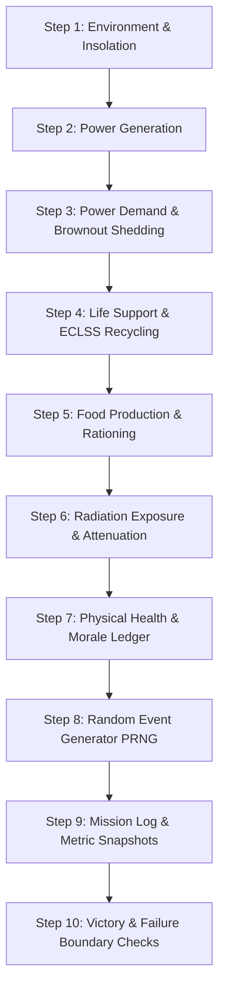

# OUTPOST ZERO: Martian Outpost Engineering Simulator

> **NASA Space Apps Challenge 2024 / STEM Mission Challenge Entry**  
> An interactive engineering simulator designed for learners aged 11–17 to experience the tangible, uncompromising trade-offs of human space exploration on Mars.

[](tests/)
[-F0A24B?style=flat-square)](scripts/run-balance.ts)
[](data/constants.json)
[](tsconfig.json)

---

## 1. Challenge & Educational Philosophy

Space-themed educational content often swings between two extremes:
1. **Oversimplified games** that treat resource management as an arbitrary cooldown timer or superficial arcade score.
2. **Technical aerospace literature** filled with differential equations and unyielding acronyms that disengage middle and high school students.

**Outpost Zero** solves this paradox by placing students directly into the seat of Mission Director for an expedition to Utopia Planitia, Mars (Sol 001 to Sol 180). With a hard cargo lander cap of **40,000 kg (40 tonnes)**, players must pack their lander with real life support hardware, power systems, shielding, and food rations. Every single kilogram allocated to one system deprives another:
- Allocate too much mass to heavy nuclear fission or regolith radiation shields, and you starve the crew of food and water rations.
- Cut life support mass by omitting closed-loop recycling, and the crew consumes 2,500+ kg of water in open-loop depletion within 90 sols.
- Rely solely on lightweight solar arrays, and an atmospheric dust storm cuts solar irradiance by 85%, triggering a cascade of life-support brownouts.
- Neglect recreation and habitat quarters, and chronic confinement stress triggers operational burnout and mission-ending crew unrest.

---

## 2. Real NASA Scientific Data & Verification

Every physical constant, consumption rate, energy requirement, and environmental parameter in Outpost Zero is backed by official NASA technical specifications and missions:

| Parameter | Value in Game | NASA Source | Mission / Document Ref | Verified? |
|:---|:---:|:---|:---|:---:|
| **Crew Daily O2 Intake** | `0.84 kg / person / sol` | NASA BVAD | NASA/TP-2015-218570 | Yes |
| **Crew Daily Water Intake** | `3.50 kg / person / sol` | NASA BVAD | NASA/TP-2015-218570 | Yes |
| **Crew Daily Food Intake** | `1.80 kg / person / sol` | NASA BVAD | NASA/TP-2015-218570 | Yes |
| **Mean Mars Solar Irradiance**| `590 W/m²` | NASA Mars Fact Sheet | NASA Goddard Space Flight Center | Yes |
| **Dust Storm Optical Depth** | `τ = 0.9 to 2.5` | Mars Science Laboratory | Curiosity / Opportunity Studies | Yes |
| **GCR Radiation Rate** | `0.67 mSv / sol` (raw) | Curiosity RAD | Hassler et al., Science 2014 | Yes |
| **LEO / Career Dose Limit** | `250 mSv / mission` | NASA-STD-3001 Vol 1 | NASA Office of Chief Health | Yes |
| **MOXIE O2 Production** | `2.00 kg / sol` (scale-up)| JPL MOXIE Team | Perseverance Rover (scaled) | Yes |
| **Kilopower Fission Power** | `10.0 kWe` | NASA STMD / LANL | Kilopower KRUSTY Project (2018) | Yes |
| **Closed-Loop ECLSS Recycler**| `90% H2O, 50% O2` | NASA BVAD & ISS ECLSS | NASA Johnson Space Center | Yes |

### Transparent Game Balance Disclosure: Radiation Scaling
Raw Martian Galactic Cosmic Radiation (GCR) is approximately `0.67 mSv/sol`. Over a 180-sol mission, an unshielded astronaut would receive ~120 mSv—a serious career health hazard, but below the acute 250 mSv threshold. In Outpost Zero, an unshielded outpost would therefore never fail within the 180-sol timeframe, removing the educational urgency of shielding decisions.

We calibrated an explicit **`radiation_gameScale = 2.2x`** in [`data/constants.json`](data/constants.json). At 2.2x (~1.47 mSv/sol), an unshielded outpost accumulates ~265 mSv by Sol 180 and fails, while deploying realistic regolith berms (40% attenuation) or storm shelters (25% baseline, 70% SPE) brings cumulative exposure down to safe levels (~106–159 mSv). This calibration is fully disclosed to students in the in-game [/how-it-works](app/how-it-works/page.tsx) curriculum page.

---

## 3. Pure Simulation Engine Architecture

The game simulation engine in [`lib/sim/`](lib/sim/) is engineered as a **pure TypeScript, zero-DOM, zero-React** finite state machine. It is fully decoupled from the UI, enabling high-speed headless Monte Carlo testing (over 2,000 sols simulated in under 100 milliseconds).

### Deterministic 10-Step Sol Tick Sequence

Every Martian sol executes through a strictly sequenced 10-step pipeline:



1. **Environmental Calculation:** Determines solar irradiance based on dust storm optical depth ($\tau$).
2. **Power Generation:** Calculates total kW from active solar arrays, nuclear fission reactors, and fuel cell generators.
3. **Power Allocation & Brownout:** Essential baseline habitat power is served first. If generation and battery reserves fall short of total demand, optional loads (greenhouse, ISRU, gym) are shed progressively. Severe unheated habitat conditions inflict hypothermia health penalties (-12 HP/sol).
4. **Life Support Consumption & Reclamation:** 4 crew members consume 3.36 kg O2 and 14.0 kg H2O daily. Closed-loop recyclers reclaim 90% water and 50% oxygen; MOXIE extracts oxygen from atmospheric carbon dioxide.
5. **Food Consumption & Agriculture:** Crew consumes 7.2 kg food/sol. Greenhouses produce fresh biomass (4.0 kg/sol) if powered and watered. Starvation reduces morale by -8/sol and health by -15/sol.
6. **Radiation Shielding:** Evaluates solar particle event (SPE) intensity against passive shielding (regolith berms 40% reduction, storm shelters 70% reduction during SPEs).
7. **Health & Morale Integration:** Crew health starts at 100%; morale starts at 100%. Confinement, brownouts, injuries, and hunger trigger penalties. Recreation modules and fresh greenhouse food provide positive morale recovery.
8. **Stochastic Event Engine:** Evaluates trigger conditions and PRNG rolls for micrometeorite strikes, dust storms, solar flares, component failures, and scientific discoveries.
9. **Ledger & Sparkline Recording:** Appends telemetry snapshots and causal attribution chains for the end-of-mission debrief.
10. **Mission Completion / Failure Checks:** Sol 180 reached = Victory. Health ≤ 0, Morale ≤ 0, or Dose ≥ 250 mSv = Failure with root cause attribution.

### Mulberry32 Seeded PRNG
All stochastic rolls use a 32-bit Mulberry32 pseudo-random number generator ([`lib/sim/rng.ts`](lib/sim/rng.ts)). Any mission can be reproduced bit-for-bit across any browser simply by sharing the mission seed via the URL hash (e.g. `/#seed=1847192`).

---

## 4. Automated 200-Seed Balance Benchmark

Outpost Zero undergoes rigorous algorithmic balance testing using 4 automated bot archetypes across 200 distinct seeds ([`scripts/run-balance.ts`](scripts/run-balance.ts)):

```
======================================================
   OUTPOST ZERO: 200-SEED BALANCE BENCHMARK
======================================================
```

| Strategy Archetype | Description | Mass Profile | Win Rate | Target Range | Status | Primary Root Cause of Failure |
|:---|:---|:---:|:---:|:---:|:---:|:---|
| **Solar-Only Bot** | Omits nuclear fission; stacks 4 solar arrays & batteries | 38,200 kg | **10%** | < 30% | **PASS** | Crew Unrest (81%) / Radiation (9%) |
| **Fission-Heavy Bot** | Focuses entirely on nuclear power; omits food/spares | 39,800 kg | **0%** | < 30% | **PASS** | Crew Unrest / Starvation (99%) |
| **Shield-Maxxer Bot** | Invests heavily in storm shelter & regolith; starves ECLSS | 39,400 kg | **0%** | < 30% | **PASS** | Crew Unrest / Resource Collapse (100%) |
| **Balanced Engineering** | Balances fission, solar, closed-loop ECLSS, berm & rations | 39,200 kg | **57%** | **55% – 75%** | **PASS** | Radiation (37%) / Unrest (6%) |

### Hardware Item Diversity in Winning Loadouts
To prevent a single "dominant strategy" or trivial meta:
- `solar_large`: Present in 76% of wins
- `fission_unit`: Present in 85% of wins
- `eclss_recycler`: Present in 74% of wins
- `regolith_shield`: Present in 65% of wins
- `moxie_scaleup`: Present in 61% of wins
- `rec_module`: Present in 41% of wins
- `greenhouse_small`: Present in 35% of wins
- `storm_shelter`: Present in 35% of wins
- `spare_parts_kit`: Present in 65% of wins
- `medical_kit`: Present in 24% of wins
- **Zero items appear in 100% of winning loadouts**, ensuring vibrant strategic decision space.

---

## 5. Live Space Weather & AI Flight Surgeon Integration

### NOAA SWPC Live Space Weather Proxy (`GET /api/space-weather`)
Connects directly to the **NOAA Space Weather Prediction Center** (Planetary K-index 1-minute observational feed). If a real-world geomagnetic storm is in progress on Earth, the game alerts players with a live telemetry banner and dynamically simulates coronal mass ejection propagation to Mars. Cached for 10 minutes with zero external keys required.

### AI Flight Surgeon Mission Debrief (`POST /api/mentor`)
At the end of any mission, players can request a personalized engineering review from the **Gemini 2.5 Flash Flight Surgeon**. The API analyzes the complete causal telemetry chain and delivers:
1. An operational verdict on the player's life support architecture.
2. The primary failure bottleneck (e.g. *"Your power grid lacked night-time storage capacity during Sol 42 dust storms"*).
3. A real NASA aerospace analogue (e.g. *"Apollo 13 lithium hydroxide canister adaptation"* or *"Skylab 4 astronaut psychological fatigue"*).
4. Concrete engineering advice for the next flight attempt.

*Graceful Degradation:* If no `GEMINI_API_KEY` is configured or if the student is offline, the system falls back to a deterministic, high-fidelity post-mortem engine based on the telemetry root cause.

---

## 6. Project Structure

```
outpost-zero/
├── app/                        # Next.js App Router
│   ├── page.tsx                # Landing screen & mission overview
│   ├── pack/page.tsx           # Cargo Manifest & Lander Loading Screen
│   ├── mission/page.tsx        # 180-Sol Live Telemetry & Event Management
│   ├── report/page.tsx         # Post-Mission Causal Debrief & AI Surgeon
│   ├── how-it-works/page.tsx   # STEM Curriculum & Formula Reference
│   ├── sources/page.tsx        # Annotated NASA Scientific Bibliography
│   └── api/
│       ├── mentor/route.ts     # Google Gemini Flight Surgeon endpoint
│       └── space-weather/route.ts # NOAA SWPC Space Weather proxy
├── components/                 # Strict Tokenized UI Components
│   ├── ui/                     # Accessible Primitive Components (Button, Panel, Tag, Tooltip)
│   ├── pack/                   # MassBar, ItemCard, ConsumablesSliders, LoadoutSummary
│   ├── mission/                # HabitatCutaway (SVG), MeterRail, MeterGauge, SolClock, EventSheet, MissionLog
│   └── report/                 # Timeline (SVG), CauseChain, MeterSparkline, ScoreBlock, MentorNote
├── data/                       # Verified NASA JSON Datasets
│   ├── constants.json          # Mission parameters & physical constants
│   ├── items.json              # 12 hardware modules with mass, power & cost
│   ├── events.json             # 15 stochastic Martian crisis scenarios
│   └── sources.json            # 7 peer-reviewed NASA citations
├── lib/                        # Pure Simulation & Business Logic
│   ├── sim/                    # engine.ts, rng.ts, loadout.ts, events.ts, scoring.ts, report.ts, bots.ts
│   ├── data.ts                 # Zod validation schemas
│   ├── sound.ts                # Web Audio API procedural sound synthesizer
│   └── format.ts               # Accessible formatting utilities
├── styles/
│   └── tokens.css              # Strict CSS variables & design system tokens
├── tests/                      # Vitest Unit Test Suites (34/34 passing)
│   ├── engine.test.ts          # Tick execution & resource depletion
│   ├── balance.test.ts         # 200-seed Monte Carlo verification
│   ├── pack.test.ts            # Mass math & launch locking
│   ├── mission.test.ts         # Simulation loop & meter integrity
│   ├── report.test.ts          # Causal chain root cause attribution
│   ├── api.test.ts             # REST route validation & rate limiting
│   ├── data.test.ts            # Zod schema integrity
│   └── rng.test.ts             # Mulberry32 PRNG distribution tests
└── scripts/
    ├── run-balance.ts          # 200-seed balance runner
    └── headless-run.ts         # Quick CLI simulation test
```

---

## 7. Quickstart & Local Development

### Prerequisites
- Node.js 18.18.0 or higher
- npm 9.0 or higher

### Installation
```bash
# 1. Clone repository
git clone https://github.com/your-username/outpost-zero.git
cd outpost-zero

# 2. Install dependencies
npm install

# 3. Start local development server
npm run dev
```

Open [http://localhost:3000](http://localhost:3000) in your browser.

### Running Test Suites
```bash
# Run all 34 automated unit and integration tests
npm run test

# Run 200-seed balance benchmark runner
npm run balance

# Type check codebase with zero emit
npx tsc --noEmit
```

### Optional: Google Gemini AI Flight Surgeon Setup
To enable live generative debriefs from the AI Flight Surgeon, create a `.env.local` file in the root directory:
```bash
GEMINI_API_KEY=your_gemini_api_key_here
```
*(The simulator works completely out-of-the-box without this key using deterministic offline templates.)*

---

## 8. NASA Space Apps Challenge Submission Details

- **Challenge Category:** Interactive STEM Gaming & Space Exploration Education
- **Intended Audience:** Middle school, high school, and introductory undergraduate students (Ages 11–17+)
- **Pedagogical Objectives:**
  - Experience multi-variable engineering optimization under hard physical constraints.
  - Understand the life-critical distinction between open-loop and closed-loop environmental controls.
  - Evaluate risk mitigation strategies against high-consequence, low-probability events (SPEs, dust storms).
  - Practice root-cause analysis when missions encounter cascading failures.

---

*“Ad Astra Per Aspera — Through hardships to the stars.”*
